# OKÉLUN — revue visuelle de la mission 005

Images produites par le banc de capture (workflow « Revue visuelle (planches) ») : le vrai jeu, rendu image par image. Cette branche ne contient que ces images et leurs pages.

Étapes : [etape-1-capsule](etape-1-capsule/index.md) · [etape-2-silhouettes](etape-2-silhouettes/index.md) · [etape-3-animations](etape-3-animations/index.md) · [mission-006-integration](mission-006-integration/index.md) · [v06-etape-0-correctif-profondeur](v06-etape-0-correctif-profondeur/index.md) · [v06-etape-0-reference-v050](v06-etape-0-reference-v050/index.md)

## Étape 1 - génération visuelle capsule (v0.1 à v0.4.1)

- Code capturé : [`76b4cf6`](https://github.com/flash82465/login_page/commit/76b4cf6f12c976923e70e74ea9ae468483deeaa1) (branche `godot/android-first`)
- Rendu : Vulkan (llvmpipe (LLVM 20.1.2, 256 bits)), 1920 × 1080, 60 images/s fixes, interface masquée
- **Équivalence avec `version/v0.4.1` : ✅ identique au pixel près sur 207 images sur 207** (états et séquences)
- Exécution : [journal et artefact](https://github.com/flash82465/login_page/actions/runs/44815368428)

Touchez une image pour l'ouvrir en grand, puis zoomez.

### Tandé - attaques

### Tandé - états et réactions

### Mabé - attaques

### Mabé - états et réactions

### Séquences animées

**Échange Tandé contre Mabé, vitesse réelle : approche, coup, garde contre coup lourd, esquive, parade** (385 Ko)

**Attaque légère de Tandé qui touche Mabé, ralenti x4 (une image par frame de jeu)** (282 Ko)

## Étape 2 - silhouettes de Tandé et Mabé (poses fixes)

- Code capturé : [`1d3f2b4`](https://github.com/flash82465/login_page/commit/1d3f2b445054b326fde3ba2f554077ddde9e70da) (branche `godot/android-first`)
- Rendu : Vulkan (llvmpipe (LLVM 20.1.2, 256 bits)), 1920 × 1080, 60 images/s fixes, interface masquée
- **Repli capsule : équivalence avec `version/v0.4.1` : ✅ identique au pixel près sur 207 images sur 207** (états et séquences)
- Exécution : [journal et artefact](https://github.com/flash82465/login_page/actions/runs/44867952840)

Touchez une image pour l'ouvrir en grand, puis zoomez.

### Tandé seul

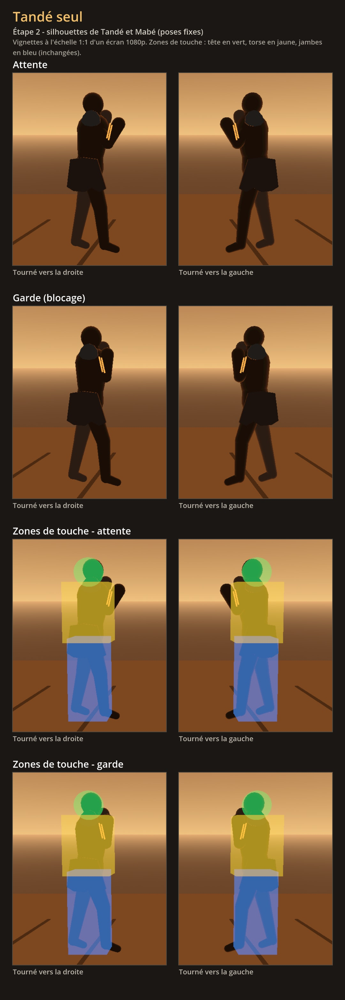

### Mabé seul

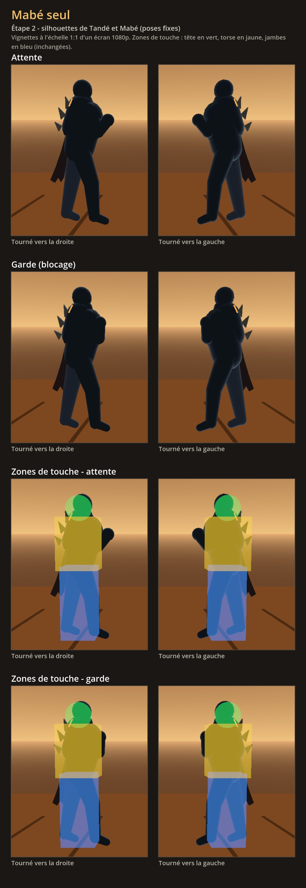

### Tandé et Mabé ensemble

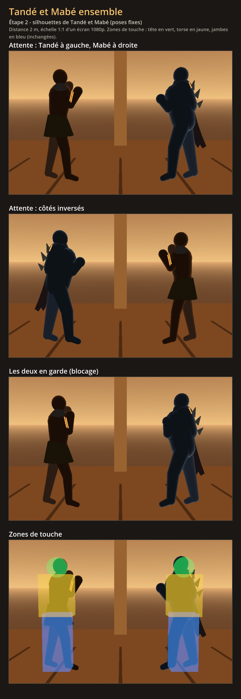

### Noir pur, sans couleurs

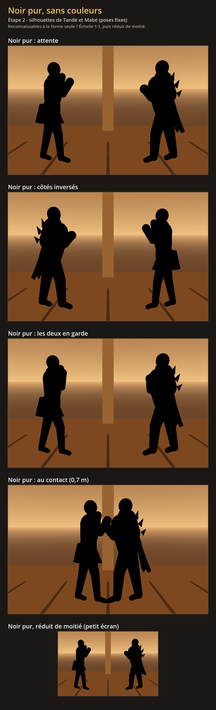

### Au contact (0,7 m, distance minimale)

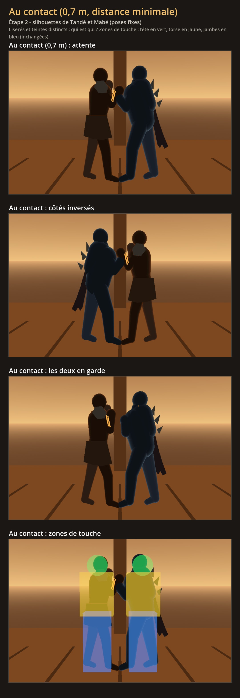

### Taille réelle sur téléphone : début du combat (3 m) (ouvrir en plein écran, téléphone à l'horizontale)

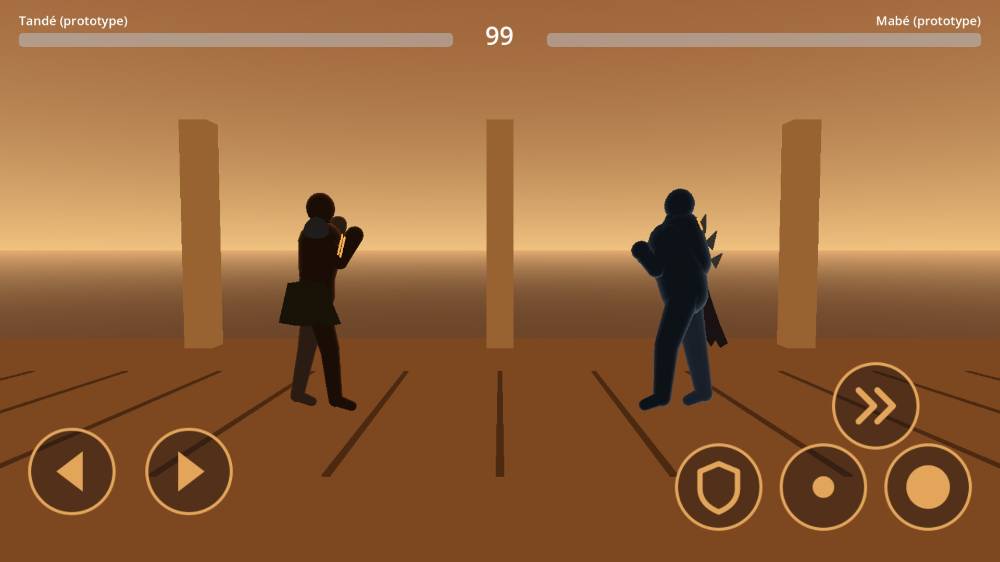

### Taille réelle sur téléphone : approche (1,4 m) (ouvrir en plein écran, téléphone à l'horizontale)

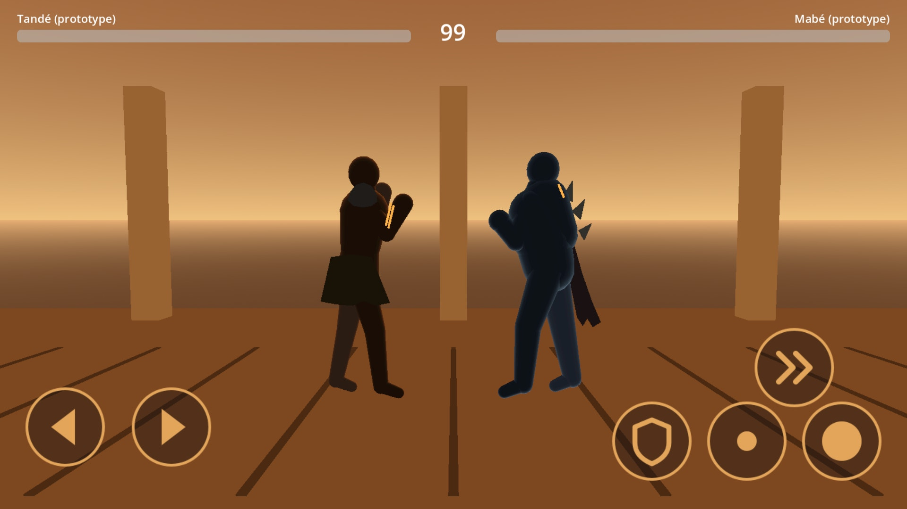

### Taille réelle sur téléphone : au contact, Mabé en garde (ouvrir en plein écran, téléphone à l'horizontale)

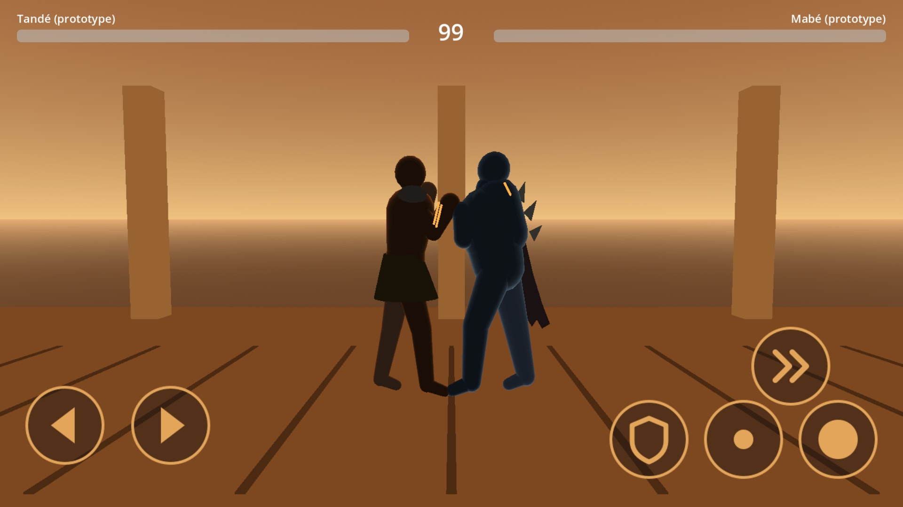

## Étape 3 - six animations des pantins Tandé et Mabé

- Code capturé : [`3eeb838`](https://github.com/flash82465/login_page/commit/3eeb838abeaa0a43651e4f00b61118bf44dd14b2) (branche `godot/android-first`)
- Rendu : Vulkan (llvmpipe (LLVM 20.1.2, 256 bits)), 1920 × 1080, 60 images/s fixes, interface masquée
- **Repli capsule : équivalence avec `version/v0.4.1` : ✅ identique au pixel près sur 207 images sur 207** (états et séquences)
- Exécution : [journal et artefact](https://github.com/flash82465/login_page/actions/runs/44872412154)

Touchez une image pour l'ouvrir en grand, puis zoomez.

### Tandé - animations

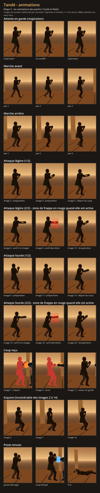

### Mabé - animations

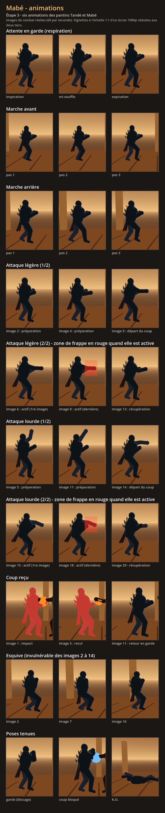

### Séquences animées

**Vrai combat : Tandé contre Mabé, chacun piloté par l'IA du jeu (12 s, vitesse réelle)** (2582 Ko)

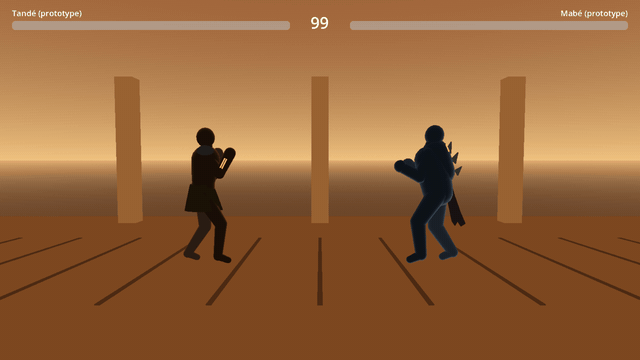

**Le même combat en vidéo (30 images/s, plus fluide)** : [ouvrir la vidéo MP4](etape-3-animations/combat-ia-video.mp4) (271 Ko)

**Coups au ralenti (x3) : légère de Tandé, lourde de Mabé bloquée, lourde de Tandé, légère de Mabé ; zone de frappe en rouge quand elle est active** (3993 Ko)

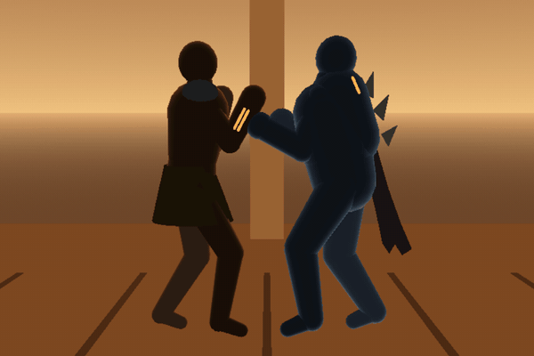

## Mission 006 - jeu intégré V0.5.0 (pantins et capsules)

- Code capturé : [`84b3f6f`](https://github.com/flash82465/login_page/commit/84b3f6fc81f9064d93ab4870d09e61b3b0dad9bc) (branche `godot/android-first`)
- Rendu : Vulkan (llvmpipe (LLVM 20.1.2, 256 bits)), 1920 × 1080, 60 images/s fixes, interface masquée
- **Repli capsule : équivalence avec `version/v0.4.1` : ✅ identique au pixel près sur 207 images sur 207** (états et séquences)
- Exécution : [journal et artefact](https://github.com/flash82465/login_page/actions/runs/44873991875)

Touchez une image pour l'ouvrir en grand, puis zoomez.

### Le jeu au démarrage : pantins animés par défaut, bouton Visuel sous le chronomètre

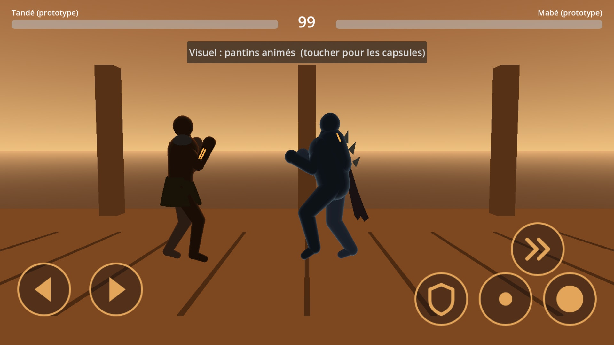

### Combat en cours avec les pantins animés

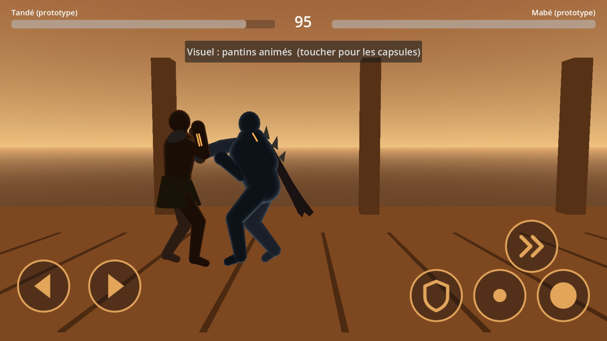

### Après un toucher sur le bouton Visuel : combat neuf avec les capsules historiques

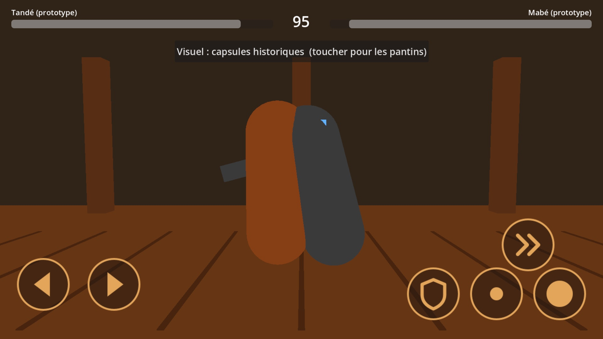

### Fin de combat avec les pantins : K.O., écran du vainqueur et bouton Rejouer

### Séquences animées

**Jeu intégré : 5 s avec les pantins, toucher sur le bouton Visuel, 5 s avec les capsules** (1249 Ko)

**La même séquence en vidéo (30 images/s)** : [ouvrir la vidéo MP4](mission-006-integration/jeu-integre-video.mp4) (203 Ko)

## V0.6-A étape 0 - correctif du bouton Profondeur (NON / OUI)

- Code capturé : [`9254b25`](https://github.com/flash82465/login_page/commit/9254b25187d6115ee57f96b7e86d7614cf468349) (branche `godot/android-first`)
- Rendu : Vulkan (llvmpipe (LLVM 20.1.2, 256 bits)), 1920 × 1080, 60 images/s fixes, interface masquée
- **Repli capsule : équivalence avec `version/v0.5.0` : ✅ identique au pixel près sur 207 images sur 207**
- **Pantins animés : équivalence avec `version/v0.5.0` : ✅ identique au pixel près sur 712 images sur 712**
- **Jeu complet, hors zone des boutons Visuel et Profondeur : équivalence avec `version/v0.5.0` : ✅ identique au pixel près sur 420 images sur 420** (zone exclue : x 0.287-0.713, y 0.094-0.283 de l'image)
- Exécution : [journal et artefact](https://github.com/flash82465/login_page/actions/runs/45049105587)

Touchez une image pour l'ouvrir en grand, puis zoomez.

### Le jeu au démarrage : pantins animés par défaut, bouton Visuel sous le chronomètre

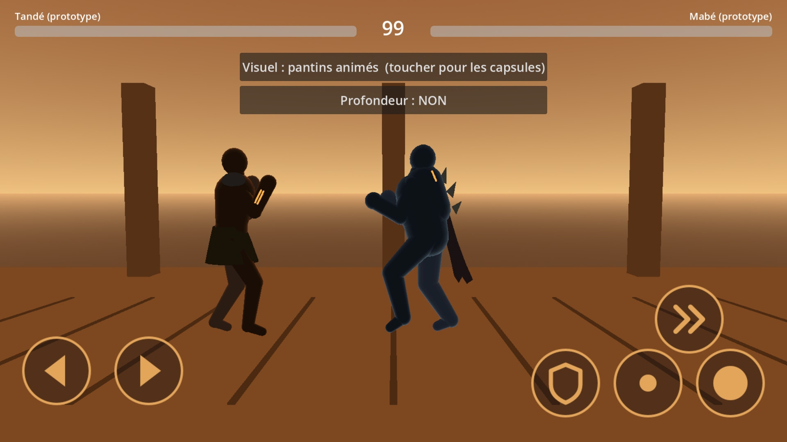

### Combat en cours avec les pantins animés

### Après un toucher sur le bouton Visuel : combat neuf avec les capsules historiques

### Fin de combat avec les pantins : K.O., écran du vainqueur et bouton Rejouer

### Bouton Profondeur sous le bouton Visuel : désactivé par défaut

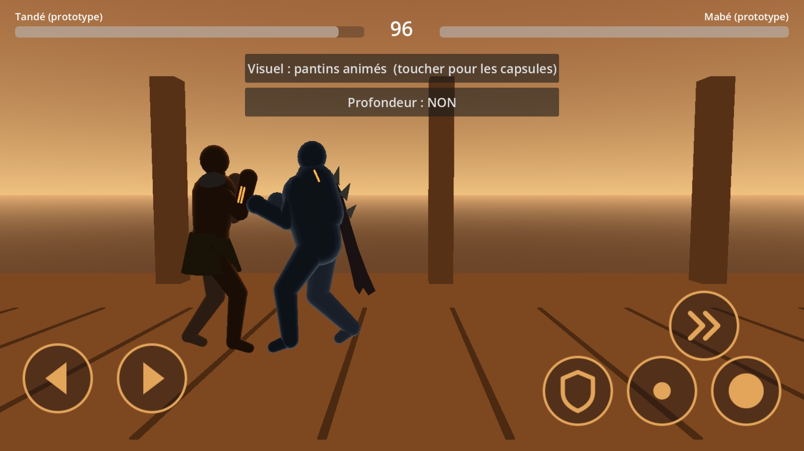

### Après un toucher : option activée (enregistrée), combat neuf ; étape 0 : encore sans effet sur le combat

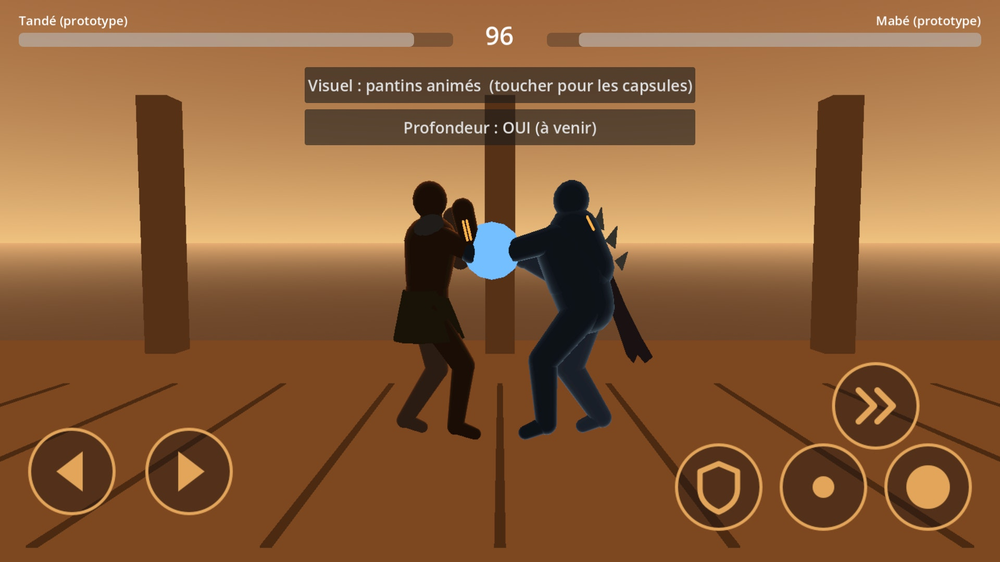

### Séquences animées

**Jeu intégré : 5 s avec les pantins, toucher sur le bouton Visuel, 5 s avec les capsules** (1242 Ko)

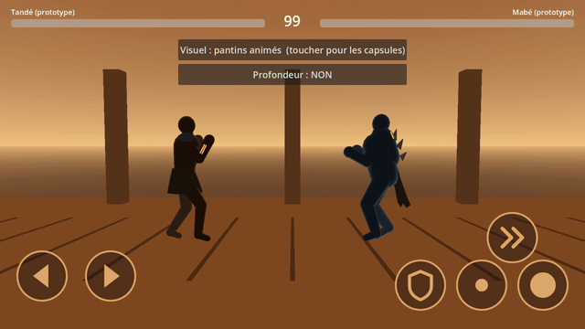

**La même séquence en vidéo (30 images/s)** : [ouvrir la vidéo MP4](v06-etape-0-correctif-profondeur/jeu-integre-video.mp4) (206 Ko)

## V0.6-A étape 0 - référence visuelle V0.5.0 (capsules, pantins, jeu complet)

- Code capturé : [`1fb22a2`](https://github.com/flash82465/login_page/commit/1fb22a2f820f09d9d0f38130a30d52f2437bdf65) (branche `godot/android-first`)
- Rendu : Vulkan (llvmpipe (LLVM 20.1.2, 256 bits)), 1920 × 1080, 60 images/s fixes, interface masquée
- **Repli capsule : équivalence avec `version/v0.5.0` : ✅ identique au pixel près sur 207 images sur 207**
- **Pantins animés : équivalence avec `version/v0.5.0` : ✅ identique au pixel près sur 712 images sur 712**
- **Jeu complet, hors zone des boutons Visuel et Profondeur : équivalence avec `version/v0.5.0` : ✅ identique au pixel près sur 420 images sur 420** (zone exclue : x 0.287-0.713, y 0.094-0.283 de l'image)
- Exécution : [journal et artefact](https://github.com/flash82465/login_page/actions/runs/45039143410)

Touchez une image pour l'ouvrir en grand, puis zoomez.

### Le jeu au démarrage : pantins animés par défaut, bouton Visuel sous le chronomètre

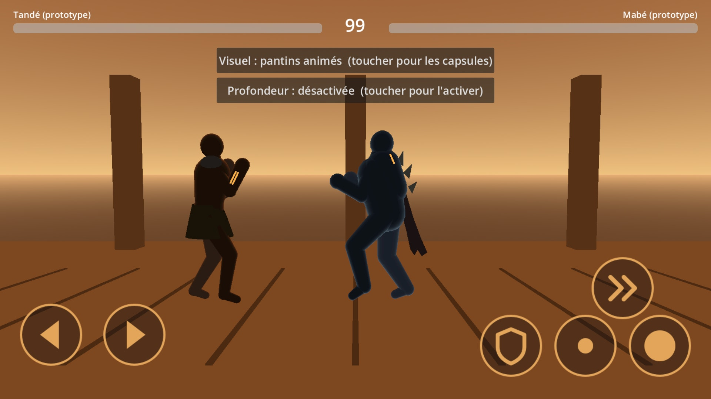

### Combat en cours avec les pantins animés

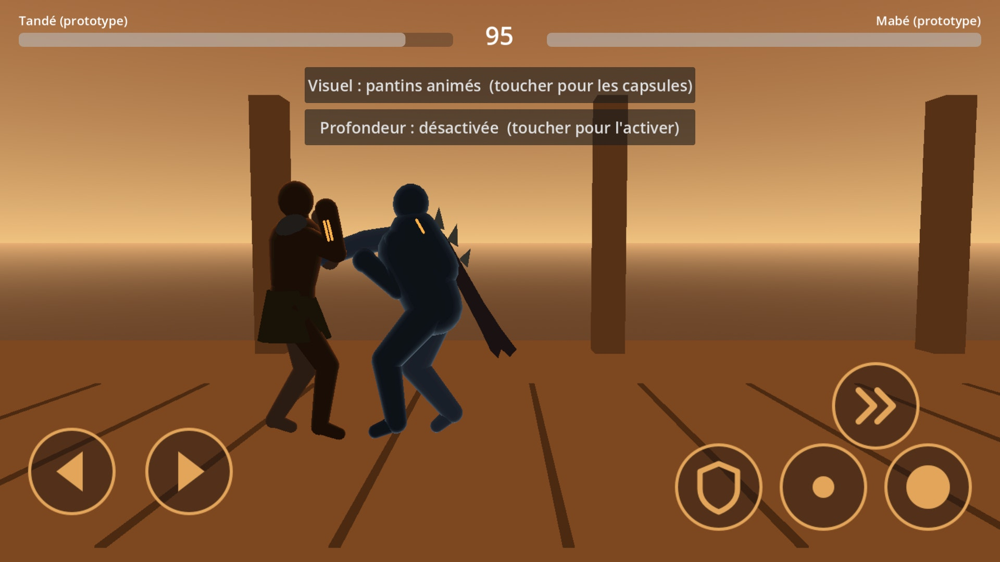

### Après un toucher sur le bouton Visuel : combat neuf avec les capsules historiques

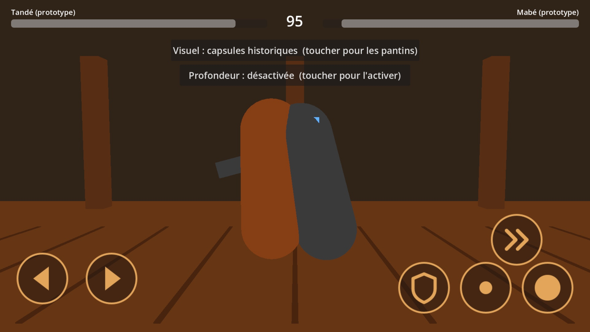

### Fin de combat avec les pantins : K.O., écran du vainqueur et bouton Rejouer

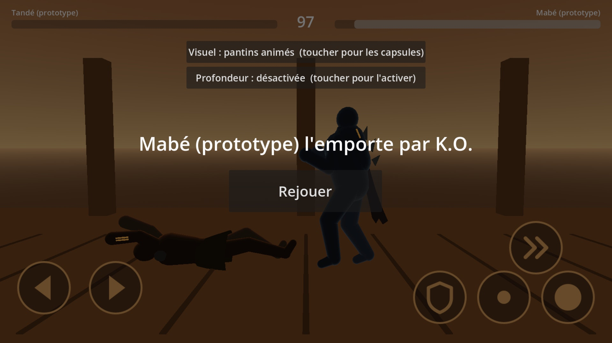

### Bouton Profondeur sous le bouton Visuel : désactivé par défaut

### Après un toucher : option activée (enregistrée), combat neuf ; étape 0 : encore sans effet sur le combat

### Séquences animées

**Jeu intégré : 5 s avec les pantins, toucher sur le bouton Visuel, 5 s avec les capsules** (1246 Ko)

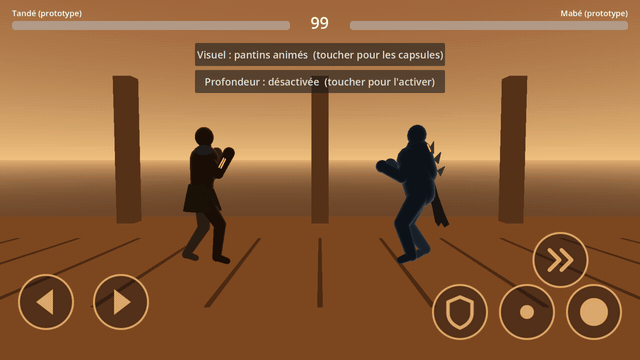

**La même séquence en vidéo (30 images/s)** : [ouvrir la vidéo MP4](v06-etape-0-reference-v050/jeu-integre-video.mp4) (209 Ko)

