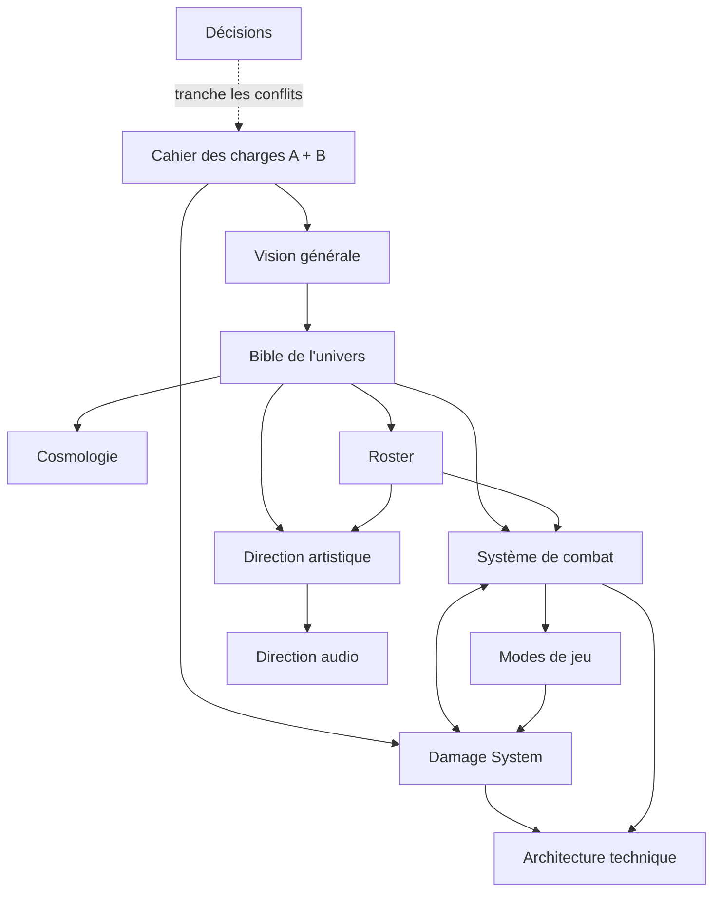

| Traçabilité | |
| --- | --- |
| Document | OKÉLUN — Index documentaire |
| Version | 0.1.0 |
| Date | 2026-11-18 (création et dernière révision connues) |
| Statut | Actif — source de vérité documentaire du projet |
| Source | Créé lors de la centralisation documentaire (mission 001) |
| Documents associés | Tous les documents de `docs/` |

<!-- FIN EN-TÊTE DE TRAÇABILITÉ -->

# OKÉLUN — Index documentaire

Ce dossier est la source de vérité unique de la documentation d’OKÉLUN. Toute modification de conception se fait ici, puis se trace dans `decisions/`.

**Statuts utilisés.** *Conçu* : l’idée existe. *Documenté* : elle est écrite ici. *Implémenté* : du code existe. *Testé* : un test automatique le vérifie. *Validé* : confirmé par l’auteur ou un playtest. À ce jour, **aucun élément n’est validé**.

## Documents

| Document | Description | Version | Statut |
| --- | --- | --- | --- |
| [vision/cahier-des-charges.md](vision/cahier-des-charges.md) | Cahier des charges original, parties A (§1–35) et B (§32–48), texte intégral non modifié | 1.0.0 | Référence |
| [vision/vision-generale.md](vision/vision-generale.md) | Pitch et piliers de l’IP (Bible §1) | 0.1.0 | Brouillon |
| [universe/bible-univers.md](universe/bible-univers.md) | Mythologie, régions, factions, chronologie, campagne, boss, règles culturelles, lexique (Bible §3–10) | 0.1.0 | Brouillon |
| [universe/cosmologie.md](universe/cosmologie.md) | Les quatre plans de réalité, avec diagramme (Bible §2) | 0.1.0 | Brouillon |
| [characters/roster.md](characters/roster.md) | 24 combattants, rivalités, règles de conception | 0.1.0 | Brouillon, noms provisoires |
| [gameplay/systeme-combat.md](gameplay/systeme-combat.md) | Commandes, ressources, physique, défense, dégâts en combat, armes, arènes, pouvoirs, caméra, technique, équilibrage | 0.1.0 | Brouillon |
| [gameplay/modes-jeu.md](gameplay/modes-jeu.md) | Modes de jeu et persistance par mode (Système de combat §11) | 0.1.0 | Brouillon |
| [art-audio/direction-artistique.md](art-audio/direction-artistique.md) | Piliers visuels, matériaux, architecture, rendu, paysages, éclairage, qualité graphique, sang et VFX, interface, production | 0.1.0 | Brouillon |
| [art-audio/direction-audio.md](art-audio/direction-audio.md) | Sound design, musique, voix et langues (Direction artistique §10–12) | 0.1.0 | Brouillon |
| [technical/damage-system.md](technical/damage-system.md) | GDD technique du Damage Priority & Resolution System | 0.1.0 | Brouillon à corriger |
| [technical/architecture-technique.md](technical/architecture-technique.md) | État technique constaté et renvois | 0.1.0 | Ébauche |
| [decisions/README.md](decisions/README.md) | Registre des décisions et questions en attente | 0.1.0 | Ouvert |
| `assets/` | Diagrammes restaurés (rendu PNG et code source) | — | — |

## Relations entre documents

## Origine des documents

Les cinq documents de conception ont été rédigés le 2026-11-18 dans Claude Docs, puis exportés en Markdown et versés ici. Pour respecter la structure demandée, quatre documents ont été **découpés aux frontières de sections existantes, sans réécriture** : chaque section déplacée est remplacée dans son document d’origine par un renvoi. Les deux diagrammes, que l’export avait remplacés par un texte de substitution, ont été restaurés à partir de leur rendu et de leur code source (`assets/`).

| Document source | Révision | Fichiers |
| --- | --- | --- |
| GDD technique — Damage Priority & Resolution System | 24 | technical/damage-system.md |
| OKÉLUN — Bible de l’univers | 11 | vision/vision-generale.md (§1), universe/cosmologie.md (§2), universe/bible-univers.md (§3–10) |
| OKÉLUN — Roster des combattants | 10 | characters/roster.md |
| OKÉLUN — Système de combat et modes de jeu | 14 | gameplay/systeme-combat.md (§1–10, 12–13), gameplay/modes-jeu.md (§11) |
| OKÉLUN — Direction artistique et audio | 14 | art-audio/direction-artistique.md (§1–9, 13), art-audio/direction-audio.md (§10–12) |
