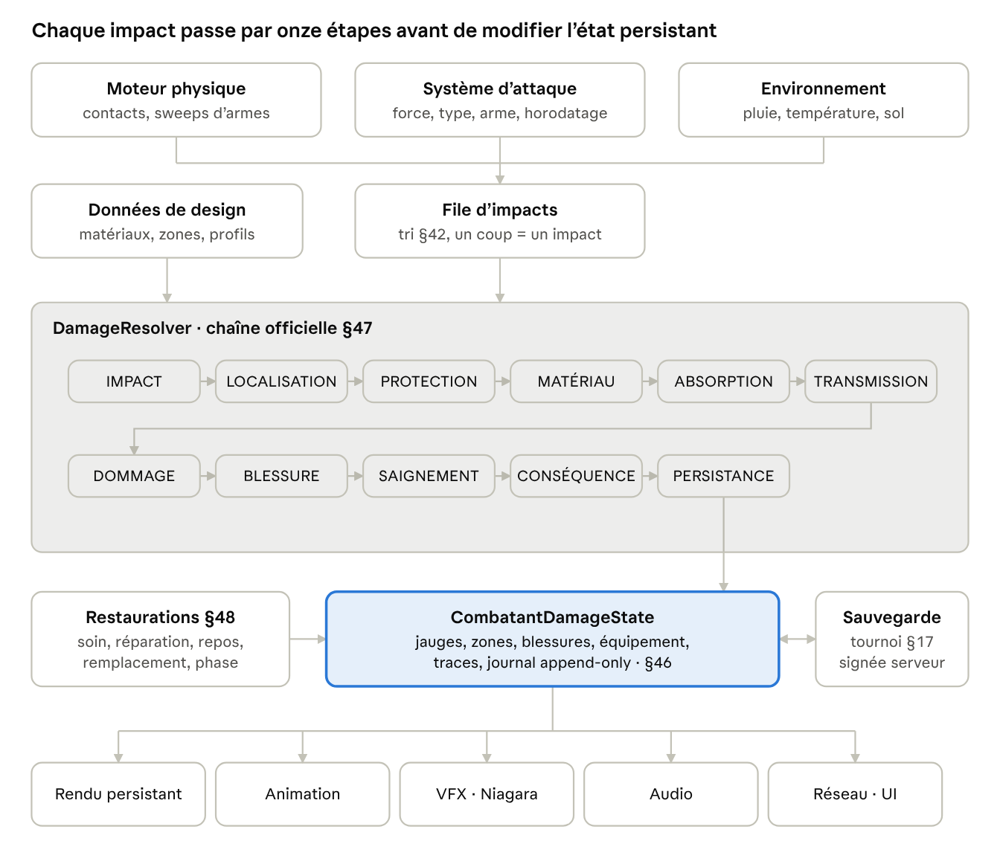

| Traçabilité | |
| --- | --- |
| Document | GDD technique — Damage Priority & Resolution System |
| Version | 0.1.0 (source : révision 24) |
| Date | 2026-11-18 (création et dernière révision connues) |
| Statut | Brouillon — à corriger : écrit avant le cahier des charges complet ; audit du 2026-11-18 ≈ 58 % de conformité ; implémenté partiellement par le prototype `damage-system/` (21 tests), non validé |
| Source | Claude Docs « GDD technique — Damage Priority & Resolution System », révision 24 ([lien](https://claude.ai/artifact/XjVFcf8wqZshrQnKvVnjNw)), export Markdown du 2026-11-18 |
| Documents associés | [Cahier des charges](../vision/cahier-des-charges.md) (partie B), [Architecture technique](architecture-technique.md), [Système de combat](../gameplay/systeme-combat.md), [Modes de jeu](../gameplay/modes-jeu.md) |

<!-- FIN EN-TÊTE DE TRAÇABILITÉ -->

# GDD technique — Damage Priority & Resolution System

Nov 18, 2026 · @peut tu modifier une video

## 0. Préambule

Ce GDD transforme les règles 32 à 48 du cahier des charges en une architecture exécutable, moteur-agnostique d'abord, puis adaptée à Unreal Engine 5. Il ne supprime aucune règle et ne simplifie pas le modèle : chaque impact produit des conséquences physiques persistantes.

**Source et lacune.** Seules les sections 32 à 48 ont été transmises. Les sections 20 à 31 n'ont jamais été fournies : aucune règle n'en est inventée ici. Les points qui en dépendent probablement (fatigue détaillée, destruction environnementale, mouvement, IA) sont construits à partir des sections 32–48 et marqués « À réconcilier avec §20–31 ».

**Principe absolu.** Un impact est résolu de l'extérieur vers l'intérieur, de l'objet touché vers le corps, puis du dommage immédiat vers ses conséquences persistantes.

**Référence existante.** Un prototype logique en JavaScript implémente déjà ces règles (dépôt `login_page`, dossier `damage-system/`, PR #1, 21 tests). Ce GDD en est la spécification de production ; les valeurs numériques reprises de ce prototype sont des points de départ à calibrer.

### Conventions

| Convention | Valeur |
| --- | --- |
| Unités spatiales | mètres, espace local du personnage (+Z avant, +Y haut) |
| Unité d'énergie | « unité d'impact » (UI), échelle abstraite commune à l'énergie et à la résistance |
| Temps | secondes de simulation, horodatage serveur |
| Intégrité | réel 0.0–1.0 (1 = 100 %) |
| Gravité de blessure | réel 0.0–1.0 |
| Débit sanguin | ml/s ; volume sanguin de référence 5 000 ml |
| Aléatoire | interdit dans toute décision de rupture ou de blessure (§37) ; autorisé uniquement en cosmétique (variation de particules) |
| Langue du code | identifiants en anglais, commentaires libres |

### Glossaire

| Terme | Définition |
| --- | --- |
| Impact | Contact physique unique entre une source d'attaque et une cible, identifié par `AttackId` + `HitIndex` |
| Couche | Objet traversé par un impact (arme, bouclier, casque, armure, secondaire, vêtement, peau) |
| Canal pénétrant | Part de l'énergie qui continue de couper ou perforer |
| Canal contondant | Part de l'énergie transmise sous forme de choc |
| Damage State | État persistant complet d'un combattant (§46) |
| Résolution | Exécution de la chaîne officielle IMPACT → PERSISTANCE pour un impact |
| Restauration | Seule voie autorisée pour améliorer un état (§48) |
| Trace | Marque visuelle persistante (sang, poussière, salissure, fissure, déchirure) |

## 1. Architecture globale

Le système est un module de résolution sans dépendance au moteur : il reçoit des impacts, les ordonne, les résout le long de la chaîne officielle en onze étapes, puis écrit le résultat dans un Damage State persistant que tous les autres systèmes lisent.



*Diagramme restauré : l’export Markdown l’avait remplacé par un texte de substitution. Rendu : `docs/assets/gdd-architecture.png` ; code source : `docs/assets/gdd-architecture.jsx`.*

Seuls le résolveur et les restaurations écrivent dans le Damage State ; rendu, animation, VFX, audio, réseau et sauvegarde ne font que le lire.

### Modules

| Module | Responsabilité | Entrées | Sorties | Sections |
| --- | --- | --- | --- | --- |
| ImpactIntake | Convertit contacts moteur, rayons et zones en `ImpactEvent` | physique, système d'attaque | impacts horodatés | 3, 7 |
| ImpactQueue | Ordonne et dédoublonne les impacts d'une frame | impacts | impacts ordonnés | 10 |
| Localizer | Construit la liste extérieur → intérieur des couches et la zone corporelle | impact, état | `Localisation` | 3 |
| LayerResolver | Absorption, transmission et dégâts structurels par couche | localisation, matériaux | canaux résiduels, événements | 4, 5, 6, 8 |
| ClashResolver | Arme contre arme | deux armes, contact | états d'armes, déviation | 9 |
| BodyResolver | Blessures, vie, conséquences physiques | canaux résiduels, zone | blessures, recul, équilibre | 11, 13 |
| BleedSimulator | Courbes de saignement dans le temps | blessures, mouvement | sang perdu, traces | 12 |
| ConsequenceMapper | Modificateurs gameplay et calques d'animation | état des zones | `GameplayModifiers` | 14 |
| PresentationPolicy | Lisibilité et budgets VFX | événements | événements filtrés | 14, 19 |
| DamageState | Mémoire persistante, journal | résolveur, restaurations | état lu par tous | 13, 16 |
| RestoreGuard | Seule voie d'amélioration d'un état | demandes de soin, réparation… | `RestoreRecord` | 18 |
| PersistenceService | Sauvegarde et chargement tournoi | Damage State | instantanés signés | 17 |

### Chaîne officielle (§47)

| Étape | Question §47 | Produit |
| --- | --- | --- |
| IMPACT | — | clé, type, force effective |
| LOCALISATION | Qu'est-ce qui a réellement été touché ? | couches + zone corporelle |
| PROTECTION | — | objets interposés |
| MATERIAU | — | résistance effective par couche |
| ABSORPTION | Qu'est-ce qui a absorbé l'impact ? | énergie absorbée par couche |
| TRANSMISSION | Quelle énergie a été transmise ? | canaux pénétrant et contondant |
| DOMMAGE | — | dégâts structurels, paliers |
| BLESSURE | Quelle conséquence physique en résulte ? | blessures |
| SAIGNEMENT | — | profils de saignement |
| CONSEQUENCE | — | recul, équilibre, douleur, fatigue, modificateurs |
| PERSISTANCE | Cette conséquence doit-elle rester visible ? | traces, journal |

Aucune étape n'est omise : une étape sans objet est enregistrée avec sa justification (ex. « aucune blessure ouverte »).

### Pipeline (pseudo-code)

```text
function ResolveImpact(state, impact) -> ImpactResult:
  key = impact.attackId + ":" + impact.hitIndex
  if key in state.processedImpacts: return Skipped("duplicate_collision")
  chain = []
  force = impact.force × Performance(impact.attackerWeapon)        ; chain.add(IMPACT)
  loc = Localize(state, impact)                                   ; chain.add(LOCALISATION)
  if loc.layers empty and loc.bodyZone is null:
    chain.addSkipped(PROTECTION..PERSISTANCE, "aucune surface touchée") ; return Miss
  state.processedImpacts.add(key)
  (M, B, layerReports, holders, events) = ResolveLayers(state, impact, loc, force)
  chain.add(PROTECTION, MATERIAU, ABSORPTION, TRANSMISSION, DOMMAGE)
  body = ResolveBody(state, loc.bodyZone, M, B, holders, impact)  ; chain.add(BLESSURE, SAIGNEMENT)
  cons = ComputeConsequences(state, body)                         ; chain.add(CONSEQUENCE)
  persistent = Persist(state, body, events, impact)               ; chain.add(PERSISTANCE)
  return ImpactResult(chain, layerReports, body, cons, Present(events), answers)
```

### Modèle d'exécution

- **Événementiel** pour les impacts : résolus en fin de pas physique, dans l'ordre de la file.
- **Ticks lents** pour ce qui dépend du temps : saignement et traces à 10 Hz, équilibre et posture à la fréquence du jeu.
- **Déterministe** : aucune décision ne dépend d'un tirage aléatoire ; mêmes entrées, même résultat.
- **Autoritaire** : en multijoueur, seul le serveur exécute le résolveur (section 20).

## 2. Zones corporelles

Le corps est découpé en 20 zones de résolution regroupées en 6 groupes fonctionnels ; chaque zone possède sa propre résistance, son facteur de saignement et son état persistant (§44). Le prototype en utilise 12 ; la version production subdivise bras et jambes pour que blessure, animation et saignement restent localisés.

### Hiérarchie

- **Groupe Tête** : Head (crâne), Face, Neck
- **Groupe Tronc** : UpperChest, Abdomen, Pelvis
- **Groupe Bras G / Bras D** : Shoulder, UpperArm, Forearm, Hand
- **Groupe Jambe G / Jambe D** : Thigh, Shin, Foot

Chaque zone est liée à un ou plusieurs os du squelette et à un ou plusieurs volumes de collision. Le groupe sert aux effets gameplay (mobilité, prise, vitesse d'attaque) ; la zone sert à la résolution et aux traces.

### Propriétés de référence

| Zone | Groupe | Ténacité (UI) | Facteur saignement | Multiplicateur vie | Seuil d'équilibre (UI) | Vitale |
| --- | --- | --- | --- | --- | --- | --- |
| Head | Tête | 45 | 1.3 | 1.6 | 35 | oui |
| Face | Tête | 35 | 1.4 | 1.4 | 40 | oui |
| Neck | Tête | 30 | 2.0 | 1.8 | 50 | oui |
| UpperChest | Tronc | 80 | 1.0 | 1.2 | 70 | oui |
| Abdomen | Tronc | 60 | 1.2 | 1.2 | 70 | oui |
| Pelvis | Tronc | 70 | 1.1 | 1.0 | 50 | non |
| Shoulder G/D | Bras | 60 | 0.9 | 0.8 | 80 | non |
| UpperArm G/D | Bras | 55 | 1.0 | 0.6 | 90 | non |
| Forearm G/D | Bras | 45 | 0.8 | 0.5 | 100 | non |
| Hand G/D | Bras | 30 | 0.7 | 0.4 | 120 | non |
| Thigh G/D | Jambe | 75 | 1.2 | 0.7 | 40 | non |
| Shin G/D | Jambe | 60 | 0.9 | 0.6 | 45 | non |
| Foot G/D | Jambe | 40 | 0.6 | 0.4 | 55 | non |

Valeurs Head, Neck, UpperChest (« Torso » du prototype), Abdomen, Shoulder, Hand issues du prototype ; les autres sont des propositions à calibrer.

### Structures de données

```text
enum BodyZoneId { Head, Face, Neck, UpperChest, Abdomen, Pelvis,
                  ShoulderL, ShoulderR, UpperArmL, UpperArmR, ForearmL, ForearmR, HandL, HandR,
                  ThighL, ThighR, ShinL, ShinR, FootL, FootR }
enum LimbGroup  { Head, Trunk, ArmL, ArmR, LegL, LegR }

struct BodyZoneDef            // donnée statique, éditable par le design
  BodyZoneId   id
  LimbGroup    group
  float        toughness          // UI nécessaires pour une gravité 1.0
  float        bleedFactor
  float        healthMultiplier
  float        balanceThreshold   // UI de choc pour une perte d'équilibre de 0.5
  bool         isVital
  BoneRef[]    bones
  HitVolume[]  volumes            // sphères, capsules, boîtes orientées

struct BodyZoneState          // donnée persistante, par combattant
  float        function           // 0..1, brute (non plafonnée)
  float        contusion          // 0..1
  FractureState fracture          // None | Cracked | Fractured
  WoundId[]    wounds
  float        bloodSaturation    // 0..1, peau de la zone
  float        dirt, dust         // 0..1
```

### Règles

- Une zone n'est jamais « supprimée » : le cahier des charges ne prévoit pas de démembrement, la fonction descend mais la zone reste.
- `function` est calculée, jamais écrite directement : `function = max(0, 1 − Σ impairment(wounds) − 0.25 · contusion − 0.3 · [fracture])`. Le plancher gameplay est appliqué plus loin (section 14), pas ici.
- Une blessure soignée compte pour 0.15 × sa gravité au lieu de 0.6 : la cicatrice gêne légèrement, elle ne disparaît pas.

## 3. Couches de protection

Toute attaque traverse une liste ordonnée de couches avant d'atteindre une zone corporelle ; chaque couche absorbe, transmet ou modifie l'énergie avant la suivante (§32 P1–P2, §35).

### Ordre de priorité (§32 P1)

| Rang | Type de couche | Exemples | Tenue |
| --- | --- | --- | --- |
| 1 | Arme | épée qui pare, hampe | tenue (main) |
| 2 | Bouclier | rondache, pavois | tenu (avant-bras) |
| 3 | Casque | heaume, bassinet | porté |
| 4 | Armure | plastron, épaulières, cotte de mailles | portée |
| 5 | Équipement secondaire | brassards, ceinture, sacoche, carquois | porté |
| 6 | Vêtements | gambison, chemise, cape | portés |
| 7 | Peau | — | corps |
| 8 | Zone corporelle sous-jacente | Thigh, UpperChest… | corps |

Le rang ne sert qu'à départager deux surfaces à la même distance (à 0,1 mm près). L'ordre réel est l'ordre physique le long de la trajectoire (§35).

### Localisation par la géométrie réelle

Trois sources, par ordre de préférence :

1. **Liste de contacts fournie par le moteur** (balayage de l'arme sur les volumes) : source de production.
2. **Lancer de rayon** sur les volumes d'équipement et de corps : projectiles, outils de debug.
3. **Repli par zone** : quand seule la zone corporelle est connue (explosion, élémentaire de zone). Les couches couvrant la zone sont prises dans l'ordre des rangs ; bouclier et arme seulement s'ils bloquent ou parent.

Les vêtements et pièces sans volume propre « épousent » la zone corporelle : ils sont insérés juste avant le corps quand celui-ci est touché.

### Couverture et interstices

Une pièce couvre des zones, mais pas forcément toute leur surface. Le plastron couvre UpperChest et Abdomen sauf les aisselles ; la cotte de mailles couvre l'aisselle. La couverture est portée par la géométrie (volumes par sous-zone de pièce), jamais par une probabilité.

### Structures

```text
enum LayerKind { Weapon=1, Shield=2, Helmet=3, Armor=4, Secondary=5, Clothing=6, Skin=7, Body=8 }

struct LayerHit
  EquipmentPieceRef piece          // null pour Skin/Body
  PieceZoneId       zone           // plastron, joint, attachment…
  Vector3           point, normal  // espace local
  float             distance       // le long de la trajectoire
  float             incidenceDeg   // 0 = perpendiculaire
  bool              implicit       // vêtement épousant le corps

struct Localisation
  LayerHit[]  layers               // extérieur → intérieur, couches actives seulement
  BodyZoneId? bodyZone             // null si l'objet tenu a tout arrêté ou si rien derrière
  Vector3?    bodyPoint
  Method      method               // EngineContacts | Raycast | ZoneFallback
```

### Construction de la liste (pseudo-code)

```text
function Localize(state, impact):
  candidates = []
  for piece in state.ActivePieces():               // détruite ou détachée = exclue (§36)
    h = NearestHit(impact.path, piece.volumes)
    if h: candidates.add(piece, h.zone, h.distance, rank(piece.kind))
  for vol in state.bodyVolumes:
    h = Hit(impact.path, vol)
    if h: candidates.add(Body, vol.zone, h.distance, 8)
  sort candidates by (round(distance, 1e-4), rank)
  layers = []
  for c in candidates:
    if c is Body: bodyHit = c; break                // on s'arrête au premier tissu touché
    if c.piece not in layers: layers.add(c)          // une pièce compte une fois par impact
  if bodyHit:
    for p in state.CoveringPieces(bodyHit.zone) without volumes, not Weapon/Shield:
      layers.add(implicit LayerHit(p, distance = bodyHit.distance))
  return Localisation(layers sorted by (distance, rank), bodyHit)
```

### Règles de passage entre couches (§35)

- Chaque couche reçoit deux canaux, pénétrant et contondant, et en émet deux (section 8).
- **Couche détruite pendant l'impact** : la fraction d'énergie qu'elle aurait dû absorber au-delà de sa réserve restante passe à la suivante. `overflow = 1 − intégrité_avant / dégât_structurel` ; `extra = absorbé × overflow`, réparti entre pénétrant (`× p`) et contondant (`× (1 − p) × 0.8`).
- **Objet tenu** (bouclier, arme qui pare) non détruit : le canal contondant ne continue pas vers la zone derrière ; 40 % part dans la zone qui tient l'objet (avant-bras, main), le reste est dissipé dans la posture et converti en perte d'équilibre. Seul le canal pénétrant continue.
- **Objet tenu détruit** : les deux canaux continuent normalement.

## 4. Matériaux et résistances

Neuf matériaux de base couvrent la liste du §32 P3 ; chacun est défini par huit propriétés physiques abstraites et une table de vulnérabilité par type d'attaque. Un équipement référence un matériau ; un même matériau peut avoir des variantes (acier trempé, fer doux) qui surchargent quelques valeurs.

### Propriétés

| Propriété | Domaine | Rôle |
| --- | --- | --- |
| resistance | UI | Énergie qu'une couche intacte arrête en un impact |
| hardness | 0..1 | Capacité à dévier coupe et perforation |
| toughness | UI | Réserve structurelle : plus elle est haute, moins un coup entame l'intégrité |
| brittleness | 0..1 | Tendance à fissurer et éclater plutôt qu'à se déformer |
| damping | 0..1 | Fraction du choc contondant dissipée (rembourrage) |
| failureMode | Brittle, Ductile, Fabric | Forme de la dégradation visible |
| flammable | 0..1 | Sensibilité au feu, inflammation |
| conductive | 0..1 | Conduction électrique et thermique |

### Table des matériaux (valeurs de départ)

| Matériau | Rés. | Dureté | Ténacité | Fragilité | Amorti | Mode | Infl. | Cond. |
| --- | --- | --- | --- | --- | --- | --- | --- | --- |
| Tissu | 6 | 0.02 | 25 | 0 | 0.10 | Fabric | 1.0 | 0 |
| Cuir | 18 | 0.15 | 60 | 0.05 | 0.25 | Fabric | 0.5 | 0 |
| Bois | 35 | 0.30 | 90 | 0.55 | 0.30 | Brittle | 0.8 | 0 |
| Verre | 10 | 0.60 | 15 | 1.00 | 0.05 | Brittle | 0 | 0 |
| Métal léger | 55 | 0.65 | 140 | 0.20 | 0.15 | Ductile | 0 | 0.9 |
| Métal lourd | 90 | 0.85 | 260 | 0.30 | 0.20 | Ductile | 0 | 1.0 |
| Composite | 70 | 0.55 | 180 | 0.35 | 0.50 | Brittle | 0 | 0.2 |
| Pierre | 80 | 0.75 | 120 | 0.85 | 0.35 | Brittle | 0 | 0 |
| Surnaturel | 120 | 0.90 | 400 | 0.10 | 0.60 | Ductile | 0 | 0 |

### Vulnérabilité structurelle par type d'attaque

Multiplicateur appliqué aux dégâts que la pièce subit elle-même (1.0 par défaut).

| Matériau | Tranchant | Contondant | Perforant | Lourd | Élémentaire |
| --- | --- | --- | --- | --- | --- |
| Tissu | 1.8 | 0.3 | 1.3 | 1.0 | 1.0 |
| Cuir | 1.3 | 0.5 | 1.1 | 1.0 | 1.0 |
| Bois | 1.1 | 1.1 | 1.0 | 1.4 | 1.0 |
| Verre | 1.0 | 2.2 | 1.5 | 2.5 | 1.0 |
| Métal léger | 0.6 | 1.1 | 0.9 | 1.3 | 1.0 |
| Métal lourd | 0.4 | 1.0 | 0.7 | 1.2 | 1.0 |
| Composite | 0.7 | 0.8 | 0.8 | 1.1 | 1.0 |
| Pierre | 0.3 | 1.4 | 0.5 | 1.8 | 1.0 |
| Surnaturel | 1.0 | 1.0 | 1.0 | 1.0 | 0.5 |

### Comparaison du §32 P3

Le cahier des charges compare *force × type × angle* à *résistance + état*. L'état est appliqué de façon multiplicative, pour qu'une pièce à 0 % n'arrête plus rien quelle que soit sa résistance de base :

```latex
E_{couche} = F \times P_{arme} \times A(\theta, type)
```

```latex
R_{eff} = \frac{R_{mat} \times R_{zone} \times Eff(palier) \times M_{elem}}{W_{local}}
```

`P_arme` = performance de l'arme attaquante (section 5), `A` = facteur d'angle (section 7), `R_zone` = résistance de la zone de pièce touchée (section 6), `Eff` = efficacité du palier (section 5), `M_elem` = modificateur élémentaire, `W_local` = faiblesse locale due aux fissures, déformations et dégâts cumulés (1 à 4).

### Interactions élémentaires et environnementales (§34)

| Élément | Effet sur la résistance | Passage direct | Effet structurel | Statut appliqué | Environnement |
| --- | --- | --- | --- | --- | --- |
| Feu | × (1 − 0.5 · infl.) | 0.4 · cond. (chaleur) | × (1 + 1.5 · infl.) | Burning si infl. > 0.4 et sec | pluie × 0.5 ; > 30 °C × 1.2 |
| Froid | — | — | × 0.4 | Embrittled (+0.35 fragilité) hors tissus | < 0 °C × 1.2 |
| Foudre | × (1 − 0.8 · cond.) | min(0.95, 0.7 · cond. · env) | × 0.3 | — | mouillé : env = 1.5 |
| Acide | — | — | × 1.8 ductile, × 1.2 sinon | Corroded | — |

Les statuts sont persistants (§48) : une pièce fragilisée par le froid le reste jusqu'à une réparation ou une phase prévue. La durée et le retour à température sont à décider (section 22).

### Structure

```text
struct MaterialDef
  MaterialId  id
  float resistance, hardness, toughness, brittleness, damping, flammable, conductive
  FailureMode failureMode
  map<AttackType, float> vulnerability
  TierThresholds tierThresholds     // light 0.875, heavy 0.625, critical 0.375 par défaut
  map<Tier, float>     tierEfficiency // 1, 0.85, 0.6, 0.3, 0 par défaut ; verre 1, 0.6, 0.3, 0.1, 0
  AudioMaterialTag audioTag ; VfxMaterialTag vfxTag  // contrats audio/VFX (section 19)
```

## 5. États des armes et armures, seuils de rupture

Chaque pièce d'équipement (arme, bouclier, casque, armure, secondaire, vêtement) porte un état persistant à deux dimensions : un **palier d'intégrité** (§36) qui fixe son efficacité, et un **stade visuel** (§37) qui fixe son apparence. Les deux ne descendent jamais sans impact et ne remontent jamais sans restauration (§48).

### Paliers d'intégrité (§36)

| Palier | Valeur nominale | Seuil par défaut | Efficacité par défaut | Description |
| --- | --- | --- | --- | --- |
| Intact | 100 % | intégrité ≥ 0.875 | 1.00 | Protection normale |
| Légèrement endommagé | 75 % | ≥ 0.625 | 0.85 | Petites fissures ou déformations |
| Fortement endommagé | 50 % | ≥ 0.375 | 0.60 | Protection réduite, structure compromise |
| Critique | 25 % | > 0 | 0.30 | Risque élevé de rupture |
| Détruit | 0 % | = 0 | 0 | Retiré du modèle de collision et du système de défense |

Les seuils et efficacités sont surchargeables par matériau et par pièce (§36 : « les valeurs exactes peuvent varier »). Une pièce **détachée** a une efficacité de 0 et quitte aussi la collision, même si son intégrité est > 0.

### Stades visuels et transitions (§37)

| De | Vers | Condition | Événement |
| --- | --- | --- | --- |
| Intact | Fissuré | croissance de fissure = dégât × fragilité × 2 > 0.02 | `Crack` |
| Fissuré | Fissuré | nouvel impact à ≤ 8 cm d'une fissure (ou même zone sans position) | `CrackAggravated` |
| Intact ou Fissuré | Déformé | déformation = dégât × (1 − fragilité) × 1.5 > 0.02 | `Deform` |
| tout stade actif | Détaché | zone de fixation et dégâts cumulés sur cette zone ≥ seuil de détachement | `Detach` (critique) |
| tout stade actif | Brisé / Rompu / En lambeaux | intégrité = 0 ; brisé si Brittle, rompu si Ductile, lambeaux si Fabric | `Shatter`, `Break`, `Shredded` (critiques) |
| Fabric, tout stade | Fabric | croissance de déchirure = dégât × 0.6 > 0.02 (nouvelle) ou déchirure proche existante | `Tear`, `TearWidened` |

La séquence nominale fissurer → se déformer → se détacher → se briser est progressive quand le matériau le permet ; le verre peut passer d'Intact à Brisé en un coup, le tissu ne se fissure jamais, il se déchire.

### Seuil de rupture : les neuf facteurs du §37

La rupture n'est jamais aléatoire. Chaque facteur exigé correspond à une variable de la formule :

| Facteur §37 | Variable |
| --- | --- |
| Puissance du coup | `E_couche` (canal principal) et `B_in` (canal contondant entrant) |
| Zone touchée | `Z_vuln` de la zone de pièce |
| Angle | `A(θ)` dans `E_couche` |
| Type d'arme | `S_type` (facteur structurel du profil) et `P_arme` |
| Matériau | `V_mat[type]`, `toughness` |
| État antérieur | `W_local`, palier courant |
| Nombre d'impacts | `zoneDamage` cumulé, `hitCount`, `crack.hits` |
| Direction de la force | normale de contact → angle ; fixation touchée → détachement |
| Vulnérabilité de la pièce | `Z_vuln`, zones de fixation |

```latex
D_{struct} = \frac{(E_{contact} \times S_{type} \times V_{mat}[type] + 0.3 \times B_{in} \times V_{mat}[contondant]) \times Z_{vuln} \times W_{local} \times M_{elem} \times k}{toughness}
```

`k = 0.25` (calibrage). L'intégrité devient `max(0, intégrité − D_struct)`.

```latex
W_{local} = \min\left(4,\ 1 + \sum_{fissures\ proches} s\acute{e}v\acute{e}rit\acute{e} + 0.5 \times d\acute{e}formation + 0.5 \times d\acute{e}g\hat{a}ts_{zone}\right)
```

### Structure d'état

```text
struct EquipmentPieceState
  float        integrity          // 0..1
  Tier         tier               // dérivé de integrity + thresholds
  VisualStage  stage              // Intact | Cracked | Deformed | Detached | Shattered | Broken | Shredded
  Crack[]      cracks             // { id, pieceZone, localPos, severity 0..1.5, hits, impactId, repaired }
  float        deformation        // 0..1
  Tear[]       tears              // { pieceZone, localPos, length }
  map<PieceZoneId, float> zoneDamage
  int          hitCount
  bool         detached, destroyed
  Status[]     statuses           // Embrittled, Burning, Corroded
  float        sharpness          // armes : 0..1
  DamageRecord[] history          // append-only

WeaponPerformance = active ? max(0.15, 0.4 + 0.6 × Eff(tier)) : 0
```

Pour une arme, la performance multiplie la force de chaque coup porté ; le tranchant (`sharpness`) baisse à chaque contact dur et réduit la pénétration des coups tranchants (à brancher : le prototype le stocke mais ne l'utilise pas encore dans la pénétration).

## 6. Zones vulnérables de l'équipement

Chaque pièce est découpée en zones de résistance différente ; viser une articulation ou une fixation est plus efficace que frapper la surface principale, et c'est là que le joueur expérimenté gagne (§43).

### Zones de référence

| Pièce | Zone | Résistance × | Vulnérabilité × | Fixation | Seuil de détachement |
| --- | --- | --- | --- | --- | --- |
| Casque | Face | 1.10 | 0.90 | non | — |
| Casque | Visière | 0.70 | 1.20 | non | — |
| Casque | Articulation (charnière) | 0.45 | 1.40 | non | — |
| Casque | Fixation (jugulaire, rivets) | 0.30 | 2.20 | oui | 0.35 |
| Armure | Plastron | 1.10 | 0.90 | non | — |
| Armure | Épaules | 0.85 | 1.00 | non | — |
| Armure | Articulations | 0.45 | 1.40 | non | — |
| Armure | Attaches (sangles, boucles) | 0.30 | 2.20 | oui | 0.35 |
| Bouclier | Face | 1.00 | 1.00 | non | — |
| Bouclier | Bord | 0.80 | 1.30 | non | — |
| Bouclier | Umbo | 1.30 | 0.70 | non | — |
| Bouclier | Poignée / sangle | 0.40 | 2.00 | oui | 0.60 |
| Arme | Lame | 1.00 | 1.00 | non | — |
| Arme | Tranchant | 0.90 | 1.30 | non | — |
| Arme | Plat | 0.80 | 1.50 | non | — |
| Arme | Garde | 1.20 | 0.80 | non | — |
| Arme | Soie (fixation lame/poignée) | 0.50 | 2.00 | oui | 0.50 |

Valeurs Face, Visière, Plastron, Épaules, Articulation, Fixation et zones d'arme issues du prototype ; Bord, Umbo et Poignée du bouclier sont des propositions.

### Règles

- La zone touchée est déterminée par le volume de collision traversé, jamais tirée au sort.
- `R_zone` réduit l'énergie que la pièce arrête ; `Z_vuln` augmente les dégâts que la pièce subit. Une articulation laisse donc passer plus d'énergie **et** s'abîme plus vite.
- Une fixation qui atteint son seuil détache la pièce entière, même si son intégrité globale est élevée : un casque intact peut tomber.
- Les faiblesses se cumulent : une fissure sur une articulation multiplie les deux effets.

### Exigences de production

- **Technical art** : chaque zone vulnérable est visible sur le modèle (rivets, sangles, jointures) et possède son propre volume de collision.
- **Animation** : les gardes et parades exposent certaines zones et en couvrent d'autres ; les volumes suivent les os.
- **Design** : l'interface ne montre aucun chiffre ; la lecture passe par le visuel (fissure, sangle effilochée) et l'audio (son de métal fêlé).

```text
struct PieceZoneDef
  PieceZoneId id                 // Face, Visor, Joint, Attachment, Plastron, Edge…
  float resistanceMultiplier
  float vulnerabilityMultiplier
  bool  isAttachment
  float detachThreshold          // dégâts cumulés sur la zone
  HitVolume[] volumes
```

## 7. Types d'impact et types de dégâts

Six types d'impact (§34) déterminent comment l'énergie se répartit entre pénétration, choc et destruction d'équipement ; ils produisent sept familles de dégâts.

### Profils d'attaque

| Type | Priorité §34 | Pénétration p(matériau) | Transmission | Structurel S | Recul | Facteur d'angle A(θ) |
| --- | --- | --- | --- | --- | --- | --- |
| Tranchant | pénétration ou coupe des matériaux vulnérables | 1 − 1.1 · dureté | 0.10 | 0.8 | 0.2 | 0.3 + 0.7 cos θ |
| Contondant | déformation, recul, perte d'équilibre, transmission | 0 | 0.60 | 1.1 | 1.0 | 0.5 + 0.5 cos θ |
| Perforant | pénétration d'une zone localisée | 1 − 0.6 · dureté | 0.08 | 0.6 | 0.15 | max(0.1, cos¹·⁵ θ) |
| Lourd | destruction ou déformation de l'équipement | 0.3 · (1 − 0.5 · dureté) | 0.50 | 2.0 | 1.3 | 0.6 + 0.4 cos θ |
| Explosif | dégâts de zone, projections, environnement | 0.25 | 0.50 | 1.5 | 1.6 | 1 |
| Élémentaire | propriétés du matériau et environnement | 0.6 | 0.30 | 1.0 | 0.05 | 1 |

`p` est borné à \[0, 1\]. Un coup tranchant ou perforant dont `A(θ) < 0.45` génère un événement `Glance` (coup qui ripe), lisible par l'animation et le son.

### Familles de dégâts produites

| Famille | Cible | Origine | Exemple de conséquence |
| --- | --- | --- | --- |
| Structurel | équipement, décor | toute couche traversée | fissure, déformation, rupture |
| Pénétrant | tissus | canal pénétrant résiduel | coupure, lacération, perforation, écrasement |
| Contondant | tissus, os | canal contondant résiduel | contusion, fracture |
| Interne (abstrait) | tronc, tête | choc contondant sur zone vitale | jauge `internalDamage` |
| Thermique | tissus, équipement | feu, froid | brûlure, gelure, statuts |
| Électrique | tissus | foudre | choc |
| Souffle | tout | explosion | blessure de souffle, projection |

### Structure d'un impact

```text
struct ImpactEvent
  AttackId     attackId          // un coup = un id, quel que soit le nombre de contacts
  int|string   hitIndex          // > 0 seulement pour les attaques multi-touches assumées
  CombatantId  attacker, target
  float        time              // horodatage serveur
  AttackType   type
  Element?     element
  float        force             // UI, avant performance d'arme
  EquipmentPieceRef? attackerWeapon
  ContactSource source           // EngineContacts | Ray(origin, direction) | Zone(bodyZone)
  float        contactArea       // m², pour l'ordre des impacts simultanés
  int          collisionPriority
  EnvironmentContext env         // wet, temperature, dusty, mud, rain
  PieceRef?    blockedWith, parriedWith
```

La force est fournie par le système d'attaque (animation, masse de l'arme, vitesse au point de contact, fatigue de l'attaquant). Son calcul exact relève probablement des sections 20–31 et reste à réconcilier.

## 8. Transmission d'énergie

L'énergie circule dans deux canaux, pénétrant et contondant ; une armure efficace vide le premier mais remplit le second, si bien qu'un coup violent garde toujours une conséquence (§33).

### Bilan par couche

Pour une couche de résistance effective `R_eff`, avec `M` l'énergie du canal principal entrante et `B` celle du canal contondant entrant :

```latex
bypass = M \times passThrough_{elem} \qquad contact = M - bypass
```

```latex
absorb\acute{e} = \min(contact, R_{eff}) \qquad surplus = contact - absorb\acute{e}
```

```latex
M_{sortie} = surplus \times p + bypass
```

```latex
B_{sortie} = B \times (1 - amorti) + surplus \times (1 - p) + absorb\acute{e} \times transmission_{type} \times (1 - amorti)
```

Ce qu'une couche absorbe sans le transmettre est dissipé en dégâts structurels (section 5), en son et en recul de la pièce.

### Arrivée sur le corps

La chair a une dureté nulle : seule la part réellement coupante ou perforante ouvre la peau, le reste devient choc. Une masse sur un torse nu ne « pénètre » pas.

```latex
B_{corps} = B + M \times (1 - p_{type}(chair)) \qquad M_{corps} = M \times p_{type}(chair)
```

### Conséquences de l'énergie transmise (§33)

| Conséquence | Formule (par zone touchée) |
| --- | --- |
| Recul (m/s) | 4 × (B × recul\_type + 0.1 × M) / masse |
| Perte d'équilibre | min(0.8, 0.5 × recul\_type × B / seuil\_équilibre\_zone) |
| Contusion (gravité) | B / (2 × ténacité\_zone) si > 0.02 |
| Fracture | B > 1.2 × ténacité et zone hors tronc |
| Douleur | + 0.4 × M / ténacité + 0.3 × gravité\_contusion |
| Fatigue | + 0.0015 × B + 0.0005 × M |
| Dommage interne abstrait | + 0.1 × B si zone du tronc ou de la tête |
| Vie | (M + 0.35 × B) × multiplicateur\_zone × 0.3, plafonné (section 14) |

### Pseudo-code de résolution des couches

```text
M = force × weaponPerformance × AngleFactor(type, loc.angle)
B = 0
holderRecoil = []
for layer in loc.layers:
  if not layer.piece.active: continue                 // cassée plus tôt dans la même frame
  mat  = layer.piece.material (statuts appliqués)
  zone = layer.piece.zone(layer.zone)
  elem = ElementalModifiers(mat, impact.element, impact.env)
  W    = layer.piece.LocalWeakness(layer.zone, layer.point)
  Reff = mat.resistance × zone.resistance × Eff(tier) × elem.resistance / W
  bypass  = M × elem.passThrough ; contact = M − bypass
  absorbed = min(contact, Reff) ; surplus = contact − absorbed
  p = clamp01(profile.penetration(mat))
  Mout = surplus × p + bypass
  Bout = B × (1 − mat.damping) + surplus × (1 − p) + absorbed × profile.transmission × (1 − mat.damping)
  D = StructuralDamage(contact, B, mat, zone, W, elem)
  result = layer.piece.ApplyStructuralDamage(D, layer)  // événements, stades, historique
  if result.brokeDuringImpact:
    extra = absorbed × result.overflow
    Mout += extra × p ; Bout += extra × (1 − p) × 0.8
  ApplyStatuses(layer.piece, elem.effects)
  WearAttackerWeapon(impact.attackerWeapon, absorbed, mat)  // section 9
  if layer.piece.isHeld and not result.brokeDuringImpact:
    holderRecoil.add(layer.piece.heldBy, Bout × 0.4) ; Bout = 0
  M = Mout ; B = Bout
if loc.bodyZone:
  pf = clamp01(profile.penetration(FLESH)) ; B += M × (1 − pf) ; M ×= pf
ResolveBody(loc.bodyZone, M, B) ; for h in holderRecoil: ResolveBody(h.zone, 0, h.energy)
```

### Exemple chiffré (prototype)

Coup lourd de 115 UI sur un plastron en métal lourd au-dessus d'un gambison : 1er impact → plastron à 76 %, 0 pénétrant, 49 UI contondant, contusion du torse 0.31. 3e impact → rupture du plastron. 4e impact → gambison en lambeaux. 5e impact → le torse est frappé directement (31 UI pénétrant, 73 UI contondant).

## 9. Interactions arme contre arme

Un choc entre deux armes est résolu deux fois, séparément, de A vers B puis de B vers A, à partir d'une énergie de contact commune (§38) ; l'arme la plus faible en matériau, masse ou état encaisse le plus.

### Variables comparées (§38)

| Caractéristique | Variable |
| --- | --- |
| Matériau | `hardness`, `toughness`, `brittleness` |
| Masse | `mass` (kg) |
| Dureté | ratio `(dureté_autre + 0.1) / (dureté_soi + 0.1)` |
| État | `W_local`, facteur d'état `1 + (1 − Eff(palier))` |
| Vitesse | `speed` (m/s) au point de contact |
| Angle | `0.4 + 0.6 cos θ` |
| Force appliquée | `force` (UI) ajoutée à l'énergie cinétique |

### Calcul

```latex
E_{choc} = \left(\tfrac{1}{2} m_A v_A^2 + F_A + \tfrac{1}{2} m_B v_B^2 + F_B\right) \times (0.4 + 0.6\cos\theta)
```

```latex
D_A = \frac{E_{choc} \times \frac{h_B + 0.1}{h_A + 0.1} \times \frac{m_B}{m_A + m_B} \times 2 \times 0.15 \times Z_{vuln,A} \times W_{local,A} \times (2 - Eff_A)}{toughness_A}
```

Symétrique pour B. Le tranchant perd `0.5 × D` si la zone est le tranchant ou la lame. Le côté dont la quantité de mouvement `m × v` est la plus faible est dévié ; le recul vaut `|p_A − p_B| / min(m_A, m_B)`.

### Issues possibles

| Issue | Condition | Conséquence gameplay |
| --- | --- | --- |
| Déviation | toujours, côté le plus faible en quantité de mouvement | ouverture, fenêtre de riposte |
| Ébréchure | fissure créée sur le tranchant | perte de tranchant |
| Torsion | déformation > 0.02 | performance réduite |
| Lame qui se détache | soie touchée et seuil atteint | arme inutilisable, désarmement de fait |
| Rupture | intégrité = 0 | arme brisée, morceaux physiques |

**Cas exigé par le §38**, vérifié par le prototype : deux épées identiques de 1,4 kg à 10 m/s ; l'une intacte, l'autre à 30 % avec une fissure de gravité 0.8 sur la lame. Au premier choc, l'épée endommagée se brise et l'épée intacte descend à 85 %.

### Usure de l'arme qui frappe une protection

Quand une arme frappe une couche, elle s'use aussi : `usure = absorbé × 0.0006 × (dureté_couche + 0.1) / (dureté_arme + 0.1)`, appliquée à la zone tranchant de l'arme. Frapper du métal lourd émousse une lame.

### Parade avec une arme

Quand l'arme du défenseur est sur la trajectoire, elle devient la couche de rang 1 : le choc arme contre arme est résolu, puis l'énergie résiduelle continue la chaîne normale (le choc contondant va dans la main qui tient l'arme).

```text
struct ClashEvent
  AttackId id ; float time
  ClashSide a, b              // { weaponRef, speed, force, pieceZone }
  float angleDeg ; Vector3 contactPoint

struct ClashResult
  SideResult a, b              // stress, weakness, integrity avant/après, palier, broken, events
  Side deflected ; float recoil ; int sparks
```

## 10. Impacts simultanés

Tous les impacts d'une même frame passent par une file unique, triée selon les six critères du §42, puis résolus un par un : chaque impact voit l'état laissé par le précédent, donc l'état exact de la protection à son instant.

### Ordre de résolution

1. **Ordre temporel réel** : horodatage du contact, regroupé par fenêtre de simultanéité (1 ms par défaut, ou un sous-pas physique).
2. **Localisation** : dans une même fenêtre, la couche extérieure d'abord (rang de la première couche touchée).
3. **Puissance** : force décroissante.
4. **Surface de contact** : la plus concentrée d'abord.
5. **Priorité de collision** : valeur décroissante, fixée par le design (ex. projectile > arme de mêlée > débris).
6. **État de la protection au moment exact** : garanti par la résolution séquentielle. Une pièce cassée par l'impact n est absente de la localisation de l'impact n + 1.

### Un coup n'est compté qu'une fois

- Clé d'unicité : `targetId | attackId | hitIndex`. Un même coup qui touche plusieurs volumes, ou le même volume sur plusieurs sous-pas, ne produit qu'un impact (le premier dans l'ordre ci-dessus).
- La clé est mémorisée dans le Damage State (`processedImpacts`) : un doublon arrivé en retard, même une frame plus tard, est rejeté.
- Une attaque qui touche volontairement plusieurs fois (fléau, rafale) incrémente `hitIndex`.
- Un même coup peut toucher deux cibles différentes : la clé contient la cible.

### Pseudo-code

```text
class ImpactQueue
  window = 0.001
  pending = []

  Push(targetState, impact): pending.add({targetState, impact, order: counter++})

  Flush(resolver):
    for it in pending: it.rank = rank of first layer in resolver.Localize(it.state, it.impact)  // lecture seule
    sort pending by (floor(time / window), rank, −force, contactArea, −collisionPriority, order)
    seen = {}
    for it in pending:
      key = it.state.id + "|" + it.impact.attackId + ":" + it.impact.hitIndex
      if key in seen or key in it.state.processedImpacts: emit Skipped(key, "duplicate_collision"); continue
      seen.add(key)
      emit resolver.ResolveImpact(it.state, it.impact)   // modifie l'état avant l'impact suivant
    pending = []
```

### Points d'attention

- Le tri de localisation se fait sur l'état d'avant la frame ; la résolution, elle, relocalise sur l'état courant. Les deux peuvent diverger si un impact casse une pièce : la résolution fait foi.
- Deux attaquants qui touchent le même défenseur à 0,4 ms d'écart sont dans la même fenêtre : c'est la localisation puis la puissance qui tranchent, pas l'ordre d'arrivée réseau.
- Le choc arme contre arme est résolu dans la même file, avant les impacts corporels de la même fenêtre (rang 1).

## 11. Système de blessures

Les blessures sont calculées seulement après la résolution des protections, dans l'ordre localisation → gravité → type → saignement → conséquences physiques (§39). Chaque blessure est un enregistrement persistant, distinct de la barre de vie.

### Types de blessure

| Type | Origine | Ouverte (saigne) | Facteur de saignement | Condition |
| --- | --- | --- | --- | --- |
| Coupure | tranchant, M > 0.5 | oui | 1.0 | M ≤ 0.6 × ténacité |
| Lacération | tranchant, M > 0.5 | oui | 1.2 | M > 0.6 × ténacité |
| Perforation | perforant, M > 0.5 | oui | 0.8 | — |
| Écrasement | lourd, M > 0.5 | oui | 0.6 | — |
| Blessure de souffle | explosif, M > 0.5 | oui | 0.7 | — |
| Contusion | canal contondant | non | 0 | B / (2 × ténacité) > 0.02 |
| Fracture | canal contondant | non | 0 | B > 1.2 × ténacité, hors tronc |
| Brûlure | feu, acide | non | 0 | élémentaire |
| Gelure | froid | non | 0 | élémentaire |
| Choc électrique | foudre | non | 0 | élémentaire |

Un même impact peut produire deux blessures dans la même zone : une ouverte (canal pénétrant) et une contusion ou fracture (canal contondant).

### Gravité

```latex
gravit\acute{e}_{ouverte} = clamp_{[0,1]}\left(\frac{M_{corps}}{t\acute{e}nacit\acute{e}_{zone}}\right) \qquad gravit\acute{e}_{contondante} = clamp_{[0,1]}\left(\frac{B_{corps}}{2 \times t\acute{e}nacit\acute{e}_{zone}}\right)
```

Une blessure de gravité ≤ 0.01 (ouverte) ou ≤ 0.02 (contondante) n'est pas enregistrée.

### Aggravation ou nouvelle blessure

- **Même zone, même type, non guérie, à ≤ 10 cm** de la blessure existante (ou sans position connue) : aggravation. `gravité = 1 − (1 − g_ancienne) × (1 − g_nouvelle)` ; la courbe de saignement repart (section 12).
- **Sinon** : nouvelle blessure, enregistrée séparément (§40).

### Structure

```text
struct WoundRecord
  WoundId     id
  BodyZoneId  zone
  WoundType   type
  float       severity            // 0..1, cumulée
  Vector3?    localPos            // sur la peau, pour décal et VFX
  float       createdAt, lastHitAt
  int         hits
  ImpactKey[] impacts
  bool        open, treated, healed
  BleedProfile? bleed ; float bleedStart ; float bloodLost
```

### Vie

```latex
PV_{bruts} = (M_{corps} + 0.35 \times B_{corps}) \times mult_{zone} \times 0.3 \qquad PV_{appliqu\acute{e}s} = \min(PV_{bruts},\ 0.45 \times PV_{max})
```

Les deux valeurs sont tracées : la physique brute reste lisible pour le débogage et l'équilibrage, le plafond est une décision gameplay (§45).

### Proportionnalité (§39)

- Une blessure ne saigne que si elle est ouverte.
- Le volume de sang initial projeté vaut `0.5 × gravité²` en intensité de trace ; les particules `min(budget, 120 × Σ gravité²)`.
- Une coupure de gravité 0.1 donne environ 1 % du sang d'une blessure de gravité 0.8 : petite coupure, petite trace.

## 12. Saignement progressif

Chaque blessure ouverte possède sa propre courbe de débit, calculée à partir de la gravité, de la zone, du type, du mouvement et du temps écoulé ; le sang perdu alimente une jauge séparée de la vie (§40).

### Profil d'une blessure

| Paramètre | Formule (s = gravité) | Gravité 0.1 | Gravité 0.8 |
| --- | --- | --- | --- |
| Débit maximal (ml/s) | s² × facteur\_zone × facteur\_type × 12 | 0.12 | 7.68 |
| Débit de début | max(débit courant si réouverture, 0.35 × max) | 0.04 | 2.69 |
| Montée (s) | 1 + 3s | 1.3 | 3.4 |
| Plateau (s) | 1 + 6s | 1.6 | 5.8 |
| Constante de décroissance τ (s) | 4 + 25s | 6.5 | 24 |
| Débit résiduel (ml/s) | 0.04 × s × max | 0.0005 | 0.25 |
| Arrêt | s < 0.35 : après montée + plateau + 4τ ; sinon jamais sans soin | 28.9 s | — |

Exemples calculés pour une coupure sur une zone de facteur 1.0.

### Phases

| Phase | Intervalle | Débit |
| --- | --- | --- |
| Début | t < 0.25 × montée | début → max, linéaire |
| Augmentation | t < montée | début → max, linéaire |
| Maximum | t < montée + plateau | max |
| Diminution | au-delà | résiduel + (max − résiduel) × e^(−(t − montée − plateau)/τ) |
| Écoulement résiduel | débit ≤ 1.5 × résiduel | idem |
| Arrêté | t ≥ arrêt | 0 |
| Traité | soin appliqué (§48) | 0 |

Le mouvement multiplie le débit par `1 + 0.5 × intensité` (intensité 0..1 fournie par la locomotion et les attaques).

### Règles du §40

- **Nouvelle attaque sur la même blessure** : gravité cumulée, nouveau profil, `bleedStart = maintenant`, début = débit courant. La courbe repart sans jamais chuter brutalement.
- **Autre zone** : nouvelle blessure, nouvelle courbe.
- **Indépendance** : le saignement ne retire pas de PV. Il vide `bloodVolume` (5 000 ml) et nourrit la fatigue : `fatigue ≥ 1.5 × (1 − bloodVolume / bloodVolumeMax)`.
- Les effets d'une perte de sang importante au-delà de la fatigue (vision, conscience, mort par hémorragie) ne sont pas définis par les sections 32–48 : à décider (section 22).

### Traces

- À chaque pas de simulation, chaque blessure dépose `ml / 400` d'intensité de sang sur la surface la plus extérieure qui couvre la zone : armure, vêtement ou peau.
- Le sol reçoit des gouttes à un rythme proportionnel au débit ; elles sont la propriété de l'arène (section 15).

### Pseudo-code (tick)

```text
function TickBleeding(state, dt, movement):
  steps = ceil(dt / 0.25) ; h = dt / steps          // sous-pas pour suivre la courbe
  repeat steps:
    state.time += h
    for w in state.wounds where w.bleed and not w.treated:
      rate = BleedRateAt(w.bleed, state.time − w.bleedStart, movement)
      if rate <= 0: continue
      ml = rate × h
      w.bloodLost += ml ; state.bloodVolume = max(0, state.bloodVolume − ml)
      state.AddTrace(Blood, w.zone, ml / 400, OutermostSurface(w.zone))
      EmitDrips(w, rate)                             // cosmétique, LOD
  state.fatigue = max(state.fatigue, 1.5 × (1 − state.bloodVolume / state.bloodVolumeMax))
```

Ce tick est événementiel côté serveur (10 Hz suffisent) ; le client interpole le débit pour les particules.

## 13. États du personnage et fatigue

Chaque combattant possède un Damage State persistant (§46) qui regroupe six jauges, l'état de ses 20 zones, ses blessures, son équipement et ses traces ; une machine à états de posture en dérive à chaque frame.

### Jauges

| Jauge | Domaine | Monte avec | Descend avec |
| --- | --- | --- | --- |
| Vie | 0..100 | restauration Soin uniquement | canaux pénétrant et contondant, plafonnée par coup |
| Volume sanguin | 0..5 000 ml | restauration Soin (transfusion, à décider) | saignement |
| Fatigue | 0..1 | chocs, efforts, perte de sang | restauration Repos |
| Douleur | 0..1 | blessures ouvertes, contusions | restauration Repos (moitié) |
| Dommage interne | ≥ 0, abstrait | chocs contondants sur tronc et tête | aucune règle définie |
| Équilibre | 0..1 (1 = stable) | récupération 0.8 par seconde | perte d'équilibre par impact, explosions |

### Fatigue

La fatigue accumulée est persistante, à distinguer de l'endurance instantanée consommée par les actions, qui relève probablement des sections 20–31 (à réconcilier).

- **Sources définies (§33)** : `+0.0015 × B + 0.0005 × M` par impact reçu ; plancher lié à la perte de sang (section 12).
- **Sources proposées** : poids d'armure porté, nombre d'actions lourdes, durée du combat. À valider.
- **Effets** : régenération d'endurance `× (1 − 0.5 × fatigue)`, force des coups portés `× (1 − 0.25 × fatigue)`. Valeurs proposées, à calibrer.
- **Récupération** : uniquement par Repos (§48), jamais par simple passage du temps en combat.

### Machine à états de posture

| État | Entrée | Sortie | Effet |
| --- | --- | --- | --- |
| Stable | équilibre ≥ 0.6 | — | contrôle complet |
| Ébranlé | 0.4 ≤ équilibre < 0.6 | équilibre ≥ 0.6 | réaction d'impact additive, garde ralentie |
| Déséquilibré (stagger) | équilibre < 0.4 | équilibre ≥ 0.4 | animation de rattrapage, actions bloquées brièvement |
| Au sol | équilibre = 0 ou projection d'explosion | animation de relevé terminée | poussière et salissures sur les zones au contact |
| Hors de combat | vie = 0 | restauration Nouvelle phase | fin de la manche |

La durée des états « Déséquilibré » et « Au sol » est fixée par l'animation et pondérée par `staggerResistance` (section 14).

### Structure complète

```text
struct CombatantDamageState
  CombatantId id
  int         schemaVersion
  float       health, maxHealth, mass
  float       bloodVolume, bloodVolumeMax
  float       fatigue, pain, internalDamage, balance
  PostureState posture
  float       time
  PhaseId     phase                          // manche, combat, tournoi
  map<BodyZoneId, BodyZoneState> zones
  map<PieceId, EquipmentPieceState> equipment
  WoundRecord[] wounds
  Traces      traces                         // blood, dust, dirt par (zone, surface)
  DamageEvent[] history                      // append-only (section 16)
  set<ImpactKey> processedImpacts
  ArchivedPiece[] archivedPieces             // pièces remplacées, conservées
```

## 14. Conséquences gameplay et arbitrage réalisme / gameplay

Les blessures modifient progressivement ce que le combattant peut faire, membre par membre, sans jamais le rendre incapable d'agir (§44) ; quand la simulation et le jeu entrent en conflit, la cohérence physique passe d'abord (§45).

### Effets par groupe de membres

Chaque groupe a une fonction moyenne `f` (moyenne des zones du groupe, chaque zone plafonnée par le bas à 0.35).

| Effet | Formule | Minimum atteignable |
| --- | --- | --- |
| Vitesse d'attaque | 0.6 + 0.4 × f(bras) | 0.74 |
| Stabilité de garde | 0.5 + 0.5 × f(bras) | 0.68 |
| Prise de l'arme | 0.5 + 0.5 × f(mains) | 0.68 |
| Maniement | 0.55 + 0.45 × min(f(mains), f(bras)) | 0.71 |
| Vitesse de déplacement | 0.55 + 0.45 × f(jambes) | 0.71 |
| Esquive | 0.5 + 0.5 × f(jambes) | 0.68 |
| Résistance au déséquilibre | 0.6 + 0.4 × f(tête) | 0.74 |
| Régénération d'endurance | 0.6 + 0.4 × f(tronc) | 0.74 |

Le prototype calcule ces moyennes sur les deux côtés ; en production, bras et main sont traités par côté (main d'arme, main de bouclier) pour que « une main blessée affecte l'utilisation d'une arme » (§44) au bon endroit.

### Effets sur l'animation

- Toute zone sous 0.6 de fonction active un calque d'animation `<zone>_impaired` (bras qui protège, jambe qui boite).
- Les calques sont additifs et pondérés par `1 − fonction` : l'effet est progressif.
- Une fracture ajoute une posture spécifique, sans retirer les actions.

### Ordre d'arbitrage (§45)

1. **Cohérence physique** : la chaîne complète est toujours calculée et enregistrée telle quelle.
2. **Lisibilité** : les événements critiques (rupture, détachement, bris, ripage, changement de palier) ne sont jamais masqués ; les événements cosmétiques sont limités à 10 par impact ; les particules de sang à 60.
3. **Équilibre compétitif** : plafond de 45 % de vie par coup ; plancher de 0.35 par zone pour les effets ; perte d'équilibre plafonnée à 0.8 par coup.
4. **Spectacle cinématographique** : ralenti proposé sur bris et rupture, jamais par-dessus la vie, l'endurance, la garde et l'état d'équipement.

### Lisibilité pour le joueur

- Le joueur comprend son état en regardant son personnage (objectif du cahier des charges) : fissures, bosses, sangles, déchirures, sang, posture.
- Un indicateur d'état d'équipement et de saignement reste disponible dans le HUD pour les cas que le visuel ne montre pas assez (dos du personnage, faible luminosité).

```text
struct GameplayModifiers
  float attackSpeed, guardStability, grip, weaponHandling
  float moveSpeed, dodge, staggerResistance, staminaRegen
  AnimLayerWeight[] impairedLayers

struct BalancePolicy               // donnée de design
  float maxHealthFractionPerHit = 0.45
  float minLimbFunction = 0.35
  float maxBalanceLossPerHit = 0.8
  int   maxCosmeticEventsPerImpact = 10
  int   maxBloodParticlesPerImpact = 60
```

## 15. Destruction environnementale

Le décor utilise la même base de matériaux et le même état d'équipement que les armures : une caisse en bois, un pilier en pierre ou une vitre se fissurent, se déforment et se brisent selon les mêmes règles (§34 explosif et élémentaire). Les règles détaillées d'arène relèvent probablement des sections 20–31 et restent à réconcilier.

### Explosions

| Élément | Règle |
| --- | --- |
| Atténuation | `(1 − d / rayon)²`, nulle au-delà du rayon |
| Répartition sur le corps | Tête 10 %, UpperChest 25 %, Abdomen 15 %, chaque bras 7,5 %, chaque jambe 12,5 %, chaque main 3,75 % ; un sous-impact par zone en mode repli par zone |
| Projection | vecteur `normalise(position − centre) × énergie × atténuation / masse × 0.5` |
| Équilibre | `− min(1, 1.2 × atténuation)` |
| Décor | brûlure au sol (rayon × 0.4), débris (énergie / 20 pièces), nuage de poussière (rayon) |
| Traces | poussière sur toutes les zones exposées |

En production, les zones masquées par un obstacle ou un bouclier doivent être exclues par un test de visibilité depuis le centre (non fait dans le prototype).

### Objets destructibles

```text
struct DestructibleProp
  PropId id ; MaterialId material
  PieceZoneDef[] zones               // un pilier a une base fragile, une porte des gonds
  EquipmentPieceState state          // même modèle que les armures
  FractureAssetRef fracture          // morceaux pré-découpés
  bool blocksPath, providesCover
```

- Une arme qui frappe un décor s'use selon la règle de la section 9.
- Un décor détruit libère des débris physiques qui peuvent eux-mêmes produire des impacts (priorité de collision basse, force plafonnée).

### Conditions environnementales

| Condition | Effet sur la résolution | Effet sur les traces |
| --- | --- | --- |
| Pluie / mouillé | foudre × 1.5, feu × 0.5, pas d'inflammation | le sang pâlit jusqu'à 25 % de son maximum ; la poussière devient boue |
| Chaleur > 30 °C | feu × 1.2 | — |
| Froid < 0 °C | froid × 1.2 | — |
| Sol poussiéreux | — | poussière sur les jambes en mouvement, sur la zone touchée |
| Sol boueux | — | salissures sur les jambes en mouvement |

### Persistance de l'arène

Le sol et le décor ont leur propre mémoire : flaques et gouttes de sang, débris, brûlures, objets brisés. Elle dure toute la manche ; sa conservation entre les combats d'un tournoi dépend du lieu (même arène ou non), à décider.

## 16. Persistance des dégâts et mémoire visuelle

Tout ce que le §46 demande de mémoriser vit dans le Damage State, et chaque changement est aussi écrit dans un journal append-only ; le rendu lit l'état, jamais le journal.

### Ce qui est mémorisé (§46)

| Élément | Champ | Rendu |
| --- | --- | --- |
| Pièces d'armure détruites | `equipment[].destroyed`, `stage` | pièce retirée ou remplacée par sa version brisée |
| Fissures | `equipment[].cracks` | masque de fissures dans le matériau (position, gravité) |
| Déformations | `equipment[].deformation` | morph target ou déplacement de sommets |
| Armes endommagées | `integrity`, `sharpness`, `cracks` | ébréchures, rayures |
| Armes cassées | `destroyed` | mesh brisé, morceaux au sol |
| Vêtements déchirés | `equipment[].tears` | masque d'opacité ou mesh déchiré |
| Blessures | `wounds[]` | décal de plaie sur la peau |
| Localisation des blessures | `wounds[].zone`, `localPos` | position du décal |
| Traces de sang | `traces.blood[(zone, surface)]` | masque de sang par surface |
| Poussière | `traces.dust` | masque de poussière |
| Salissures | `traces.dirt` | masque de boue |
| Fatigue | `fatigue` | respiration, posture, animations |
| État des membres | `zones[].function`, `fracture` | calques d'animation |
| État général | jauges + posture | ensemble des éléments ci-dessus |

### Journal des dommages

```text
struct DamageEvent              // append-only
  EventId id ; float time ; ImpactKey? impact
  EventKind kind                // Impact, StructuralDamage, Wound, BleedPhase, Restore, PhaseChange…
  Ref subject                   // pièce, zone, blessure
  Payload before, after         // valeurs utiles à l'audit et au replay
```

- Le journal sert à l'audit (§48), au replay, à l'écran de fin de combat (historique) et à l'équilibrage.
- Il est compacté entre deux combats : on garde les événements critiques et un résumé par pièce et par zone ; l'état, lui, n'est jamais compacté.

### Du Damage State au rendu

```text
OnDamageStateChanged(delta):
  for piece in delta.pieces:
    mid = piece.dynamicMaterial
    mid.SetCrackMask(piece.cracks)            // texture de masque mise à jour par écriture localisée
    mid.SetScalar("Deformation", piece.deformation)
    if piece.stage changed: SwapMeshOrSpawnFracture(piece)
  for (zone, surface) in delta.traces:
    PaintMask(surface, zone, kind, intensity)  // sang, poussière, boue
  for w in delta.newWounds: SpawnWoundDecal(w)
  AnimLayers.Update(GameplayModifiers)
```

- Le rendu n'invente rien : toute trace affichée correspond à une valeur de l'état, ce qui garantit la cohérence après chargement et en réseau.
- Le LOD réduit la résolution des masques, jamais leur existence : un personnage lointain reste ensanglanté.

## 17. Persistance entre les combats d'un tournoi

En mode tournoi, le Damage State de chaque combattant est sauvegardé à la fin de chaque combat et rechargé tel quel au début du suivant (§46) ; seules les restaurations prévues par les règles du tournoi s'appliquent entre les deux.

### Cycle

1. Fin du combat : la résolution se termine, le saignement est simulé jusqu'à la sortie de l'arène.
2. Sauvegarde : instantané complet, versionné, signé par le serveur.
3. Entre-combats : le joueur ou les règles appliquent des restaurations explicites (soin, réparation, repos, remplacement), chacune journalisée.
4. Chargement : l'instantané est rechargé, migré si le schéma a changé, puis vérifié.
5. Combat suivant : `processedImpacts` est vidé (nouvelle phase), tout le reste est conservé.

### Contenu de l'instantané

```text
struct TournamentSnapshot
  int        schemaVersion
  TournamentId tournament ; int roundIndex ; CombatantId combatant
  CombatantDamageState state            // complet, sauf processedImpacts
  DamageEvent[] compactedHistory
  RestoreRecord[] pendingRestores       // décidées mais pas encore appliquées
  bytes      serverSignature            // empêche l'édition locale
```

### Restaurations entre deux combats

Le cahier des charges autorise soin, réparation, repos, équipement de remplacement et nouvelle phase explicitement prévue (§48). Leur quantité entre deux combats est une décision de design non tranchée. Proposition de cadre :

| Restauration | Exemple de règle de tournoi | Ce qui reste |
| --- | --- | --- |
| Repos | fatigue −0.5, douleur −0.25, équilibre remis à 1 | dommage interne, blessures |
| Soin | blessures traitées (saignement arrêté), gravité −0.3, vie +X | cicatrices, historique |
| Réparation | intégrité +0.25, plafonnée à 0.9 ; fissures marquées « réparées » | marques de réparation visibles |
| Remplacement | pièce détruite remplacée par une pièce de l'inventaire | pièce ancienne archivée |
| Nouvelle phase | nom de phase obligatoire ; nettoyage des traces ou vie pleine seulement si la phase le prévoit | journal complet |

Les budgets (temps, ressources, médecin, forgeron) déterminent la profondeur stratégique du tournoi : un combattant peut choisir de réparer son armure plutôt que de soigner son bras.

### Vérifications au chargement

- La signature correspond, sinon le chargement est refusé.
- Invariants de la section 18 vérifiés : aucune pièce détruite redevenue active, aucune blessure disparue, aucune intégrité supérieure à la précédente sans restauration correspondante dans le journal.
- `Infinity` (arrêt de saignement jamais atteint) est sérialisé explicitement : le JSON ne le supporte pas, le prototype le reconstruit au chargement.

## 18. Règles de non-réinitialisation

Un dommage enregistré ne disparaît jamais arbitrairement : toute amélioration d'un état passe par une restauration nommée, journalisée et limitée (§48). Détruit = détruit, cassé = cassé, fissuré = fissuré, déchiré = déchiré, endommagé = endommagé, blessé = blessé.

### Invariants

| N° | Invariant |
| --- | --- |
| I1 | `integrity` ne monte que par Réparation ; une pièce `destroyed` ne redevient jamais active (seul un Remplacement la retire) |
| I2 | `cracks`, `tears`, `stage` ne sont jamais effacés ; une réparation ajoute `repaired = true` |
| I3 | une blessure n'est jamais supprimée ; le soin la marque `treated` ou `healed` |
| I4 | `zones[].function` est recalculée depuis les blessures, jamais écrite |
| I5 | les traces de sang ne descendent que par les conditions environnementales, et jamais sous 25 % de leur maximum |
| I6 | toute modification positive d'une jauge est précédée d'un `RestoreRecord` dans le journal |
| I7 | `processedImpacts` n'est vidé qu'à un changement de phase |
| I8 | une pièce remplacée est archivée avec tout son état |

### Restaurations autorisées

| Raison | Peut | Ne peut pas |
| --- | --- | --- |
| Soin | arrêter un saignement, réduire une gravité, rendre des PV | supprimer une blessure, effacer une cicatrice |
| Réparation | augmenter l'intégrité jusqu'à un plafond, rattacher une pièce détachée | réparer une pièce détruite, effacer une fissure |
| Repos | réduire fatigue et douleur, rétablir l'équilibre | soigner une blessure |
| Remplacement | équiper une nouvelle pièce à la place d'une autre | effacer l'historique de l'ancienne |
| Nouvelle phase | changer de phase, et seulement si la phase le déclare : nettoyer les traces, rendre la vie | s'exécuter sans nom de phase |

### Garde

```text
function Restore(state, reason, payload):
  if reason not in {Heal, Repair, Rest, ReplaceEquipment, NewPhase}:
    reject("Raison non reconnue. Détruit = détruit.")
  if reason == Repair and state.equipment[payload.piece].destroyed:
    reject("Pièce détruite : utiliser ReplaceEquipment")
  if reason == NewPhase and payload.phase is empty: reject("Phase explicite requise")
  if not RulesAllow(currentMode, reason, payload): reject("Interdit par les règles du mode")
  Apply(reason, payload)
  state.history.append(RestoreRecord(reason, payload, time))
```

- En production, `Restore` n'est appelable que par le serveur et depuis des systèmes identifiés (médecin, forge, script de phase).
- Les champs d'état ne sont pas modifiables directement par le gameplay : seules la résolution et `Restore` y écrivent. Un test automatique vérifie I1–I8 après chaque combat simulé.

## 19. Contrats par discipline

Chaque discipline consomme les mêmes événements et le même état ; ce qui suit liste ce que chacune doit produire pour que la simulation soit visible.

### Animation

- Réactions d'impact indexées par zone (20), direction (4) et intensité de recul (faible, moyenne, forte).
- Calques additifs de handicap par zone (bras qui protège, jambe qui boite, main crispée), pondérés par `1 − fonction`.
- États de posture : ébranlé, déséquilibré, au sol, relevé.
- Réactions d'arme : déviation, ébréchure, lame brisée (enchaînement vers « arme cassée en main »), ripage.
- Fatigue : respiration et posture paramétrées par `fatigue`.

### VFX

| Événement | Effet | Piloté par |
| --- | --- | --- |
| Crack, CrackAggravated | éclats, poussière de matériau | matériau, gravité |
| Deform | étincelles (métal), éclats (bois) | matériau |
| Detach | pièce physique qui tombe | pièce |
| Shatter, Break, Shredded | fracture pré-découpée, morceaux | pièce |
| Clash | étincelles (nombre fourni) | dureté min × énergie |
| Blessure ouverte | jet de sang initial | gravité², plafonné à 60 particules |
| Saignement | gouttes, coulées | débit courant |
| Explosion | souffle, débris, poussière, brûlure au sol | énergie, rayon |
| Statuts | flammes, givre, corrosion | statut |

### Technical art

- Masques par pièce : fissures, déformation, sang, poussière, boue ; masques par zone de peau : sang, poussière, plaies.
- Morph targets ou déformation procédurale pour les bosses d'armure.
- Versions brisées et fractures pré-découpées pour chaque pièce destructible.
- Volumes de collision par zone de pièce, alignés sur la géométrie visible (articulations, fixations).
- Budget mémoire des masques par personnage (section 21).

### Design gameplay

- Toutes les valeurs des sections 2 à 15 sont des données éditables (tables de matériaux, zones, profils, politique d'équilibre), jamais du code.
- Outil de tir de test : choisir une arme, un angle, une zone, voir la chaîne complète.
- Visualisation debug : couleur par palier, fissures, valeurs de canaux.

### Audio

- Matrice de sons par paire (matériau de l'arme, matériau touché) et par stade (premier contact, fissure, rupture).
- Son de métal fêlé quand une pièce passe en palier critique : c'est une information tactique.
- Respiration et voix pilotées par fatigue et douleur.

## 20. Adaptation Unreal Engine 5

Le cœur de résolution reste du C++ pur sans dépendance à l'Actor, appelé par des composants UE5 ; Blueprints et Data Assets servent au réglage et à la présentation, jamais à la résolution elle-même.

### Correspondance des modules

| Module agnostique | Classe UE5 | Couche |
| --- | --- | --- |
| Résolveur | `FDamageResolver` (C++ pur) + `UDamageResolutionSubsystem` (`UWorldSubsystem`) | C++ |
| File d'impacts | `FImpactQueue`, vidée en fin de tick physique par le subsystem | C++ |
| Damage State | `FCombatantDamageState` (USTRUCT) dans `UCombatantDamageComponent` | C++ |
| Pièce d'équipement | `UDamageablePieceComponent` sur chaque mesh d'équipement + `FEquipmentPieceState` | C++ |
| Matériaux, zones, profils | `UDamageMaterialDataAsset`, `UBodyZoneDataAsset`, `UAttackProfileDataAsset`, `UBalancePolicyDataAsset` | Data Assets |
| Localisation | sweeps multi-touches sur un canal dédié `ECC_DamageLayer` | C++ |
| Volumes corporels | Physics Asset : chaque corps lié à une `BodyZoneId` via un mapping os → zone | Asset |
| Rendu persistant | Dynamic Material Instances + Render Targets de masques | C++ / Matériaux |
| VFX | Niagara, piloté par Niagara Data Channels | Niagara |
| Destruction | Chaos Geometry Collections pour pièces et décor | Chaos |
| Effets gameplay | Gameplay Ability System : attributs et Gameplay Effects | GAS |
| Tournoi | `UTournamentSaveGame` + sérialisation de `FCombatantDamageState` | C++ |

### Localisation

- Chaque arme porte des sockets le long de la lame ; à chaque sous-pas physique, un sweep de capsule entre la position précédente et la courante (évite qu'une arme rapide traverse une cible sans la toucher).
- Le sweep renvoie toutes les surfaces sur `ECC_DamageLayer` ; elles sont converties en `LayerHit` (pièce, zone de pièce via le nom du corps ou une Physical Material, distance, normale) puis passées comme source « contacts moteur ».
- Les Physical Materials portent l'identifiant de matériau du système : audio, VFX et résolution partagent la même clé.

### GAS

- Attributs : `Health`, `BloodVolume`, `Fatigue`, `Pain`, `Balance`, plus les modificateurs de la section 14.
- La résolution ne se fait pas dans un `GameplayEffectExecutionCalculation` (chaîne multi-couches trop riche) : le C++ résout, puis applique ses sorties via des Gameplay Effects instantanés ou infinis (handicaps).
- Les tags GAS décrivent les postures (`State.Staggered`, `State.Downed`) et les statuts d'équipement.

### Blueprints

- Événements exposés : `OnLayerDamaged`, `OnTierChanged`, `OnPieceDetached`, `OnPieceDestroyed`, `OnWound`, `OnBleedPhaseChanged`, `OnClash`, `OnRestore`.
- Les Blueprints réagissent (sons, caméra, UI) ; ils ne modifient jamais l'état. `Restore` n'est exposé qu'aux systèmes autorisés, côté serveur.

### Réseau

- Serveur autoritaire : seul le serveur résout. Le client prédit uniquement le cosmétique (étincelles, son de contact).
- Réplication de l'état par `FFastArraySerializer` (blessures, fissures, pièces) pour n'envoyer que les deltas ; les jauges en propriétés répliquées quantifiées.
- Événements critiques en RPC multicast fiables ; cosmétiques en non fiable.
- Le saignement tourne côté serveur à 10 Hz ; le client interpole le débit pour ses particules.

### Rendu persistant

- Un Render Target par pièce majeure et par zone de peau visible, écrit par un matériau « pinceau » à la position UV du contact.
- Atlas de masques par personnage pour limiter la mémoire (section 21).
- Les masques sont reconstruits depuis l'état au chargement d'une sauvegarde ou à l'arrivée d'un client en cours de partie.

## 21. Risques, incohérences et limites techniques

Les plus gros risques sont la détection fiable des contacts, le coût mémoire des traces persistantes, l'effet boule de neige de la persistance en compétition et la réconciliation réseau d'un état qu'on ne peut pas « rembobiner ».

### Performances

| Risque | Gravité | Mitigation |
| --- | --- | --- |
| Sweeps multi-touches par arme et par sous-pas (4 combattants × 2 armes × 4 sous-pas) | Haute | sweeps actifs seulement pendant les fenêtres d'attaque ; canal dédié ; capsules simples |
| Résolution des couches | Faible | quelques dizaines d'opérations par impact ; aucune allocation dans la boucle |
| Tick de saignement | Faible | 10 Hz serveur, nombre de blessures borné par fusion |
| Render Targets de masques | Haute | atlas, résolution par LOD, budget fixe par personnage (à chiffrer en pré-production) |
| Particules de sang et débris | Moyenne | plafonds par impact et par scène, pooling Niagara |
| Geometry Collections Chaos | Moyenne | fractures pré-découpées, nettoyage des morceaux hors caméra |

### Persistance des dégâts

- **Croissance de l'état** : le journal est append-only et `processedImpacts` grandit à chaque coup. Compactage entre combats ; `processedImpacts` remplacé par une fenêtre glissante de quelques secondes en production.
- **Migration de schéma** : un tournoi peut s'étaler sur plusieurs mises à jour du jeu. Version de schéma obligatoire et migrations testées.
- **Triche** : une sauvegarde locale éditable casserait la règle de non-réinitialisation. Sauvegardes signées par le serveur ; tournoi en ligne uniquement autoritaire.
- **Fusion des fissures et blessures** : sans fusion, une pièce frappée 200 fois accumule 200 fissures. Rayons de fusion (8 cm et 10 cm) et plafond par pièce.

### Simulation du sang

- Une vraie simulation fluide est hors budget : sang = particules courtes + décals + masques. Le réalisme vient de la cohérence avec le débit, pas de la physique du fluide.
- Accumulation sur toute une arène : flaques plafonnées en nombre, fusionnées par proximité.
- Classification d'âge (PEGI, ESRB) : le volume de sang et les plaies doivent pouvoir être réduits par une option sans changer la simulation.

### Collisions

- **Effet tunnel** : une lame à 15 m/s parcourt 25 cm par frame à 60 i/s. Sweeps entre positions successives obligatoires.
- **Décalage animation / physique** : la lame visible et la capsule doivent coïncider, sinon le joueur voit un coup toucher sans effet ou l'inverse.
- **Interstices d'armure** : la couverture dépend de volumes fins ; trop fins, ils sont ratés par les sweeps, trop gros, ils éliminent l'intérêt des zones vulnérables.
- **Couches implicites** : les vêtements sans volume sont supposés couvrir toute la zone ; une chemise ouverte ou une cape doivent recevoir des volumes.
- **Déformation non reflétée dans la collision** : une armure cabossée garde ses volumes d'origine. Acceptable si la déformation reste visuelle.

### Réseau et multijoueur

- **Ordre temporel réel (§42) contre latence** : deux coups simultanés pour les joueurs arrivent au serveur à des instants différents. Il faut une compensation de latence (résolution aux horodatages client validés), sinon le joueur le plus proche du serveur gagne les échanges.
- **Rollback impossible à bas coût** : un état qui casse des pièces et crée des blessures ne se rembobine pas proprement. Le cosmétique est prédit, les dommages jamais ; le joueur ressent un léger délai sur les conséquences.
- **Déterminisme flottant** : sans résolution côté client, le déterminisme n'est pas exigé ; il le devient si l'on vise le lockstep ou les replays par recalcul.
- **Bande passante** : répliquer des milliers de fissures est coûteux. Deltas, quantification et plafonds.

### Équilibrage compétitif

- **Boule de neige** : le premier à bien toucher affaiblit durablement l'adversaire ; en tournoi, l'avance se cumule entre combats. Les budgets de restauration entre combats sont le principal levier.
- **Domination de l'armure lourde** : le métal lourd arrête presque toute coupe. Contrepoids nécessaires (masse, fatigue, vitesse, sensibilité à la foudre et aux coups lourds).
- **Déterminisme exploitable** : sans hasard, les joueurs trouveront l'angle et la zone optimaux. C'est voulu (§43), mais il faut s'assurer qu'une seule combinaison ne domine pas.
- **Plafond de 45 % par coup** : protection contre le one-shot, mais un coup réaliste à la gorge sans protection devrait être létal. Tension assumée par le §45, à valider en playtest.

### Incohérences relevées dans le cahier des charges

| Point | Incohérence | Proposition |
| --- | --- | --- |
| §32 P3 | « résistance + état » suggère une addition | multiplication par l'efficacité du palier, pour qu'une pièce à 0 % n'arrête rien |
| §48 et §46 | « sang versé = traces persistantes selon les conditions » contre « ne jamais supprimer » | la pluie atténue jusqu'à un plancher de 25 %, jamais à 0 |
| §36 | « supprimée du modèle de collision » contre morceaux visibles | la pièce quitte la défense ; ses débris deviennent des objets physiques séparés |
| §40 | saignement indépendant de la vie, sans issue définie | définir ce qui arrive à 0 ml ou sous un seuil (section 22) |
| §44 | effets progressifs, sans démembrement | pas de démembrement ; à confirmer |
| §34 | attaque élémentaire sans liste d'éléments | feu, froid, foudre, acide proposés |
| §20–31 | non fournies | toute règle qui en dépend reste marquée « à réconcilier » |

### Limites du prototype actuel

- Bras et jambes en une seule zone chacun, effets de membres moyennés sur les deux côtés.
- Le tranchant des armes est stocké mais n'agit pas encore sur la pénétration.
- Les explosions ne testent pas la visibilité depuis le centre.
- Les événements d'usure de l'arme attaquante sont mélangés aux événements du défenseur (marqués, mais dans la même liste).

## 22. Questions ouvertes et prochaines étapes

Ces décisions bloquent la relecture critique ou le prototype ; elles doivent être tranchées avant l'implémentation.

### Questions ouvertes

- [ ] Fournir les sections 20 à 31 et réconcilier les points marqués « à réconcilier » (fatigue, endurance, calcul de la force, arènes).
- [ ] Que se passe-t-il à faible volume sanguin : vision, perte de conscience, défaite par hémorragie ?
- [ ] Le dommage interne abstrait a-t-il un effet et un soin ?
- [ ] Démembrement : exclu ou prévu ?
- [ ] Budgets de restauration entre combats d'un tournoi (temps, ressources, médecin, forgeron).
- [ ] Durée des statuts élémentaires (fragilisé, en feu, corrodé).
- [ ] Conservation de l'arène entre deux combats d'un même tournoi.
- [ ] Plafond de 45 % par coup : maintenu pour les zones vitales sans protection ?
- [ ] Cible réseau : 1 contre 1 uniquement, ou plus de combattants ?

### Prochaines étapes

1. **Relecture critique** de ce GDD par gameplay, programmation, technical art et réseau, en commentaires dans le document.
2. **Prototype interactif** : un banc de test où l'on choisit arme, angle, zone et force, et où l'on voit la chaîne, l'état des pièces et la courbe de saignement. Le module JavaScript existant (`damage-system/`) peut en être le moteur logique.
3. **Implémentation** : module C++ agnostique, tests repris du prototype, puis intégration UE5 selon la section 20.
