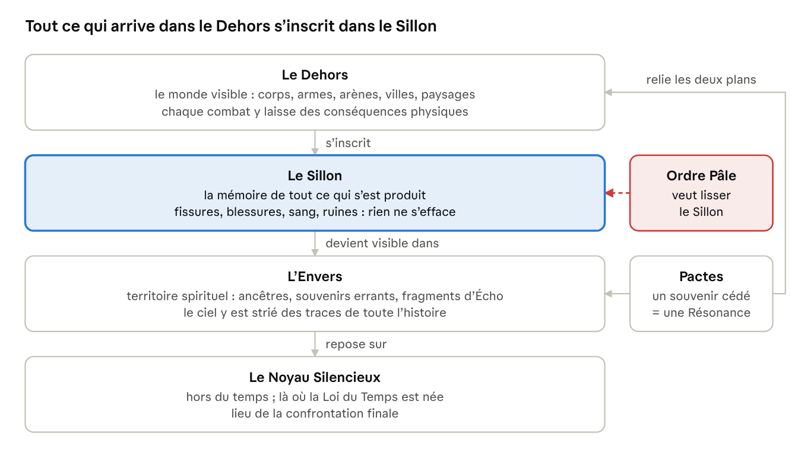

| Traçabilité | |
| --- | --- |
| Document | OKÉLUN — Cosmologie (Bible de l’univers, §2) |
| Version | 0.1.0 (source : Bible, révision 11) |
| Date | 2026-11-18 (création et dernière révision connues) |
| Statut | Brouillon — conçu et documenté ; non implémenté, non validé |
| Source | Claude Docs « OKÉLUN — Bible de l’univers », révision 11 ([lien](https://claude.ai/artifact/18sLU9v6hdndRWeGxUbSNt)), export Markdown du 2026-11-18 |
| Documents associés | [Bible de l’univers](bible-univers.md), [Vision générale](../vision/vision-generale.md) |

<!-- FIN EN-TÊTE DE TRAÇABILITÉ -->

> Extrait de la Bible de l’univers (§2), déplacé sans modification lors de la centralisation documentaire. Le reste du document est dans le fichier d’origine.

<!-- DÉBUT CONTENU DÉPLACÉ -->
## 2. Cosmologie

La réalité de Nkàra a quatre plans superposés ; le joueur ne voit d'abord que le Dehors, puis découvre au fil de l'histoire que le monde visible n'est qu'une partie d'une réalité plus vaste.

*Diagramme restauré : l’export Markdown l’avait remplacé par un texte de substitution. Rendu : `docs/assets/bible-cosmologie.png` ; code source : `docs/assets/bible-cosmologie.jsx`.*

Les Pactes relient un combattant du Dehors à un fragment d'Écho de l'Envers ; l'Ordre Pâle s'attaque directement au Sillon, ce qui ferait disparaître les traces dans le Dehors.

| Plan | Ce qu'on y trouve | Comment on y accède | Rôle en jeu |
| --- | --- | --- | --- |
| Le Dehors | le monde physique | naturellement | combats, exploration, toutes les arènes ordinaires |
| Le Sillon | la mémoire de tout événement | on ne s'y rend pas ; on le lit ou on l'altère | justification diégétique des dégâts persistants ; lueur ocre des traces |
| L'Envers | ancêtres, Échos, souvenirs | sanctuaires, mort imminente, Pacte | chapitres de révélation, arène La Plaine des Échos |
| Le Noyau Silencieux | l'origine de la Loi du Temps | seulement par la fin de la campagne | confrontation finale |

