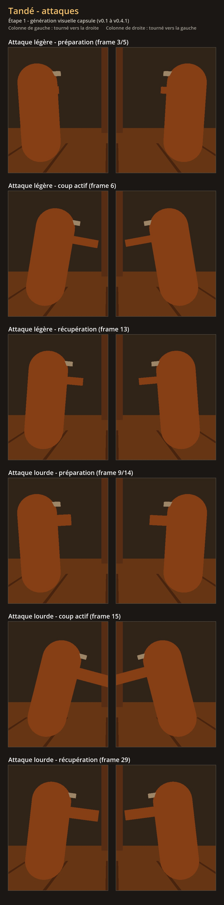
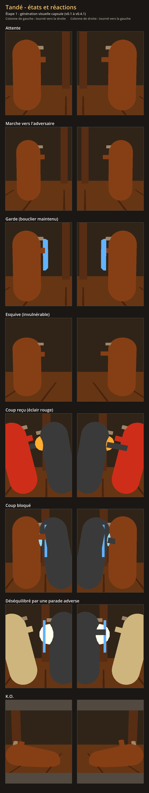
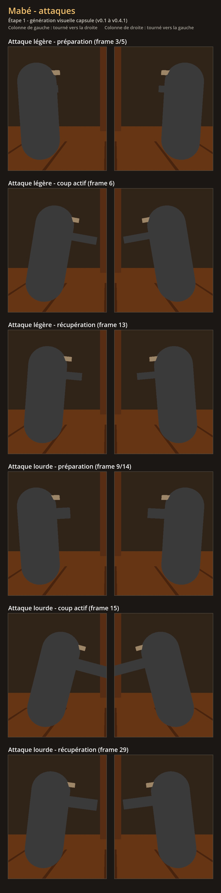
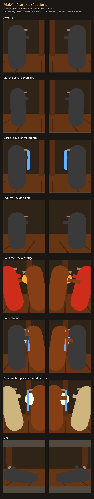
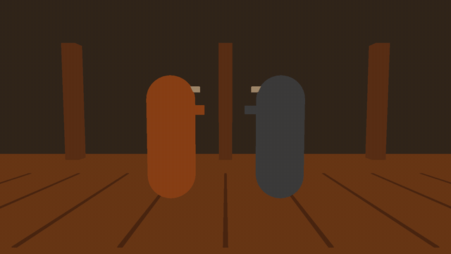
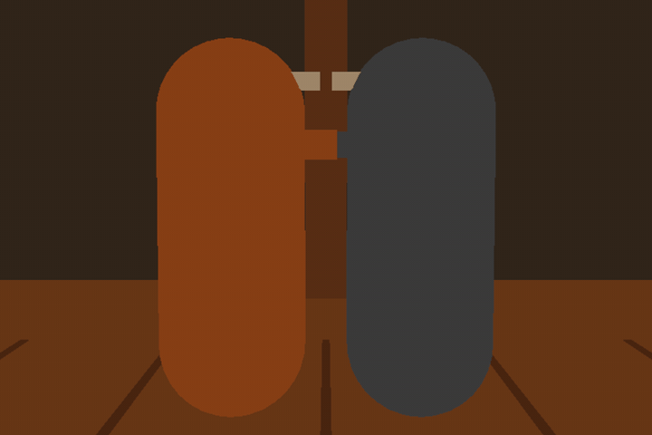

# Étape 1 - génération visuelle capsule (v0.1 à v0.4.1)

- Code capturé : [`10353c2`](https://github.com/flash82465/login_page/commit/10353c2e47f9ba728e7f8a38fce35dfdd3089cd0) (branche `godot/android-first`)
- Rendu : Vulkan (llvmpipe (LLVM 20.1.2, 256 bits)), 1920 × 1080, 60 images/s fixes, interface masquée
- **Équivalence avec `version/v0.4.1` : ✅ identique au pixel près sur 207 images sur 207** (états et séquences)
- Exécution : [journal et artefact](https://github.com/flash82465/login_page/actions/runs/44814478578)

Touchez une image pour l'ouvrir en grand, puis zoomez.

### Tandé - attaques

### Tandé - états et réactions

### Mabé - attaques

### Mabé - états et réactions

### Séquences animées

**Échange Tandé contre Mabé, vitesse réelle : approche, coup, garde contre coup lourd, esquive, parade** (385 Ko)

**Attaque légère de Tandé qui touche Mabé, ralenti x4 (une image par frame de jeu)** (282 Ko)

