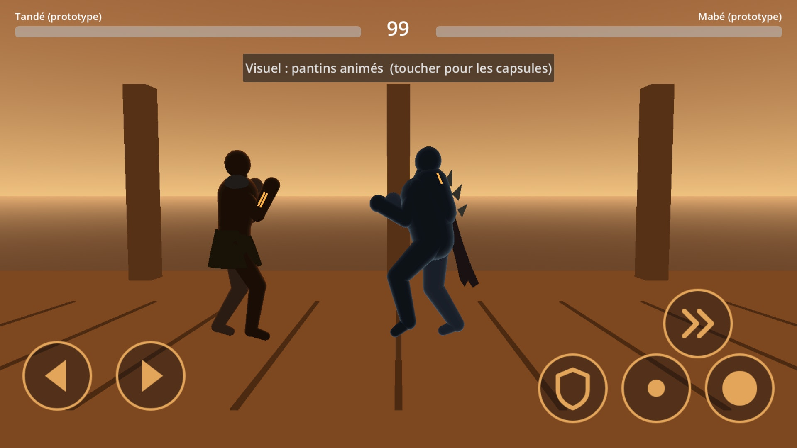
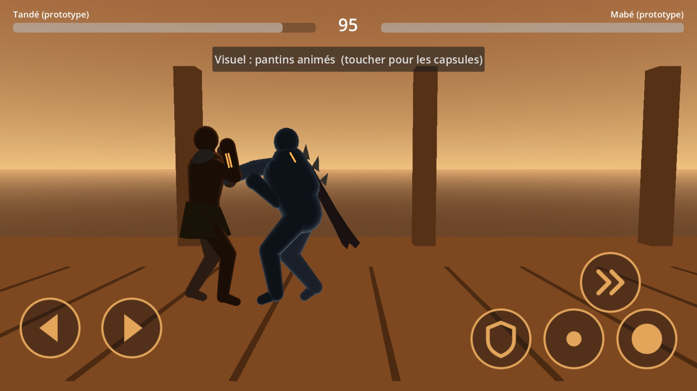
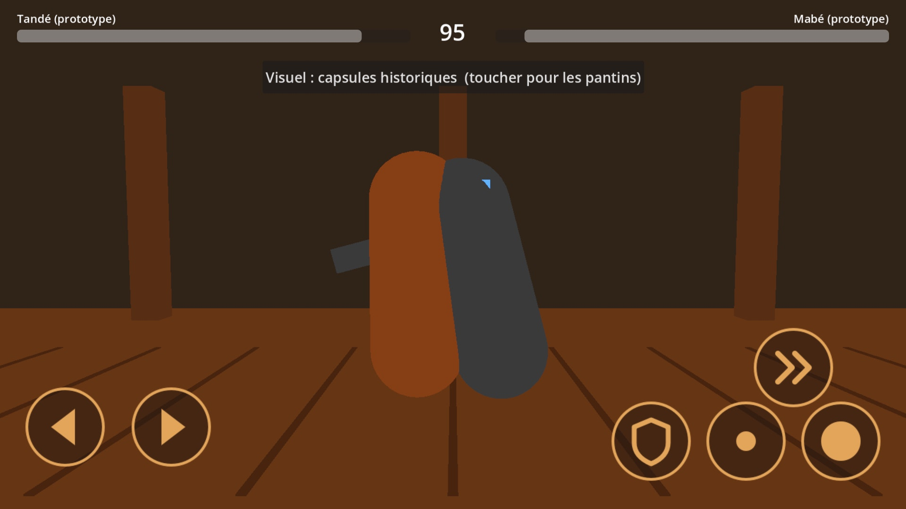
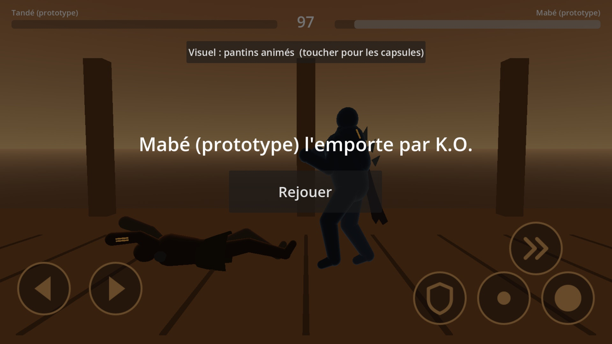
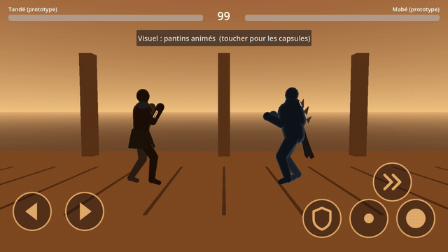

# Mission 006 - jeu intégré V0.5.0 (pantins et capsules)

- Code capturé : [`84b3f6f`](https://github.com/flash82465/login_page/commit/84b3f6fc81f9064d93ab4870d09e61b3b0dad9bc) (branche `godot/android-first`)
- Rendu : Vulkan (llvmpipe (LLVM 20.1.2, 256 bits)), 1920 × 1080, 60 images/s fixes, interface masquée
- **Repli capsule : équivalence avec `version/v0.4.1` : ✅ identique au pixel près sur 207 images sur 207** (états et séquences)
- Exécution : [journal et artefact](https://github.com/flash82465/login_page/actions/runs/44873991875)

Touchez une image pour l'ouvrir en grand, puis zoomez.

### Le jeu au démarrage : pantins animés par défaut, bouton Visuel sous le chronomètre

### Combat en cours avec les pantins animés

### Après un toucher sur le bouton Visuel : combat neuf avec les capsules historiques

### Fin de combat avec les pantins : K.O., écran du vainqueur et bouton Rejouer

### Séquences animées

**Jeu intégré : 5 s avec les pantins, toucher sur le bouton Visuel, 5 s avec les capsules** (1249 Ko)

**La même séquence en vidéo (30 images/s)** : [ouvrir la vidéo MP4](jeu-integre-video.mp4) (203 Ko)

