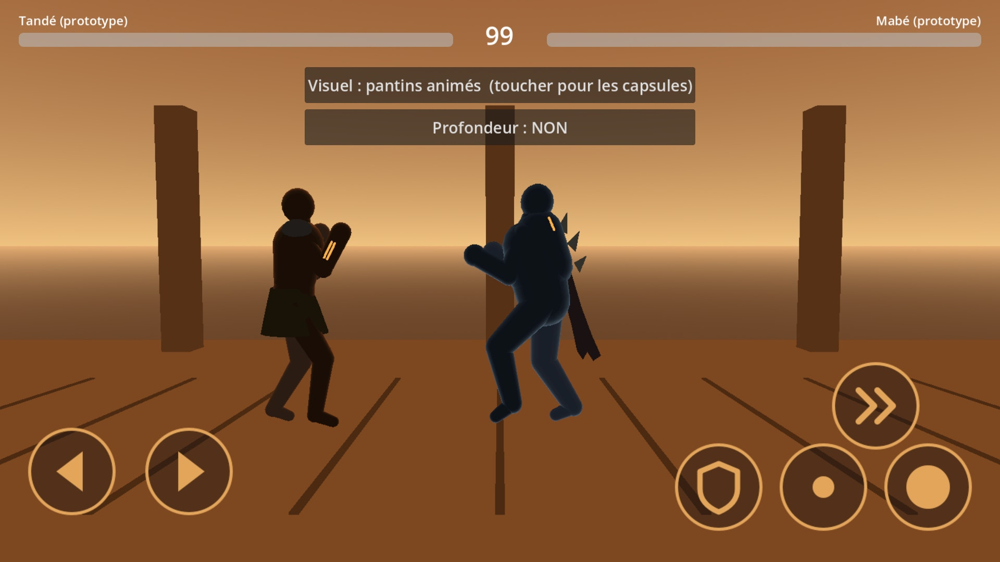
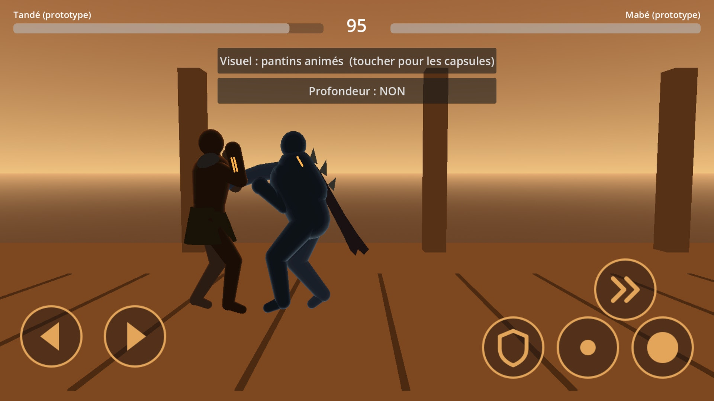
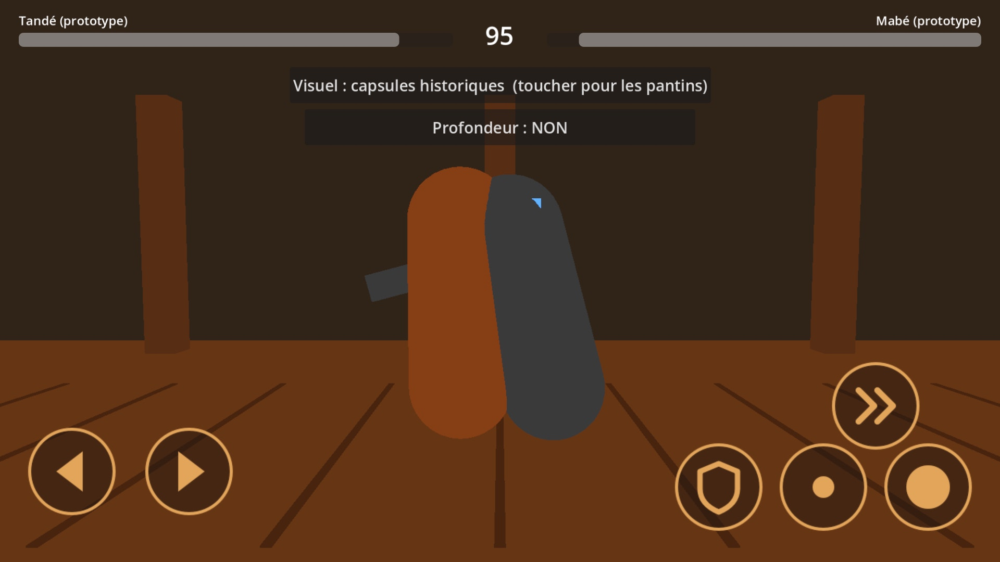
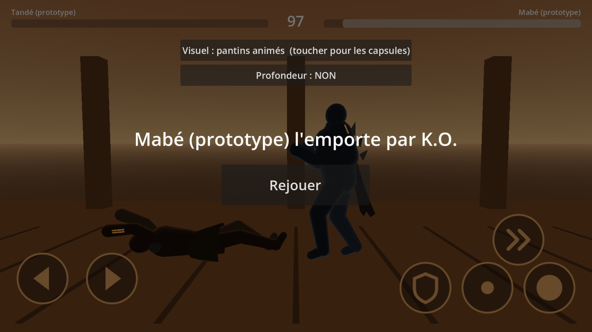
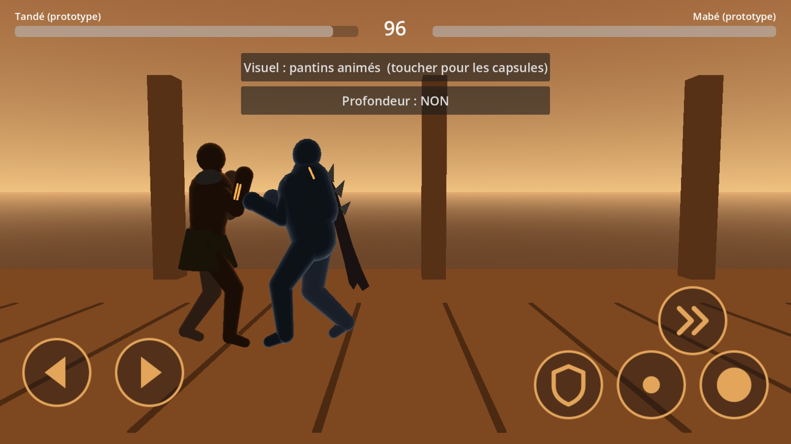
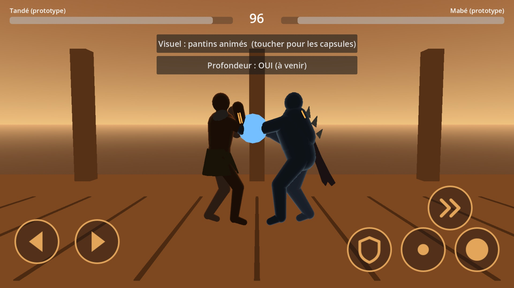
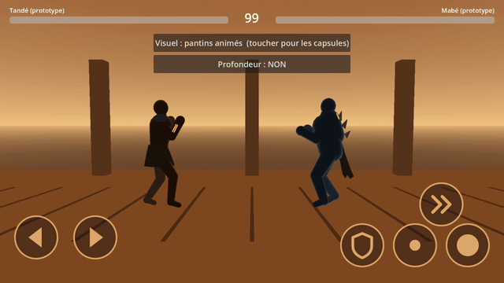

# V0.6-A étape 0 - correctif du bouton Profondeur (NON / OUI)

- Code capturé : [`9254b25`](https://github.com/flash82465/login_page/commit/9254b25187d6115ee57f96b7e86d7614cf468349) (branche `godot/android-first`)
- Rendu : Vulkan (llvmpipe (LLVM 20.1.2, 256 bits)), 1920 × 1080, 60 images/s fixes, interface masquée
- **Repli capsule : équivalence avec `version/v0.5.0` : ✅ identique au pixel près sur 207 images sur 207**
- **Pantins animés : équivalence avec `version/v0.5.0` : ✅ identique au pixel près sur 712 images sur 712**
- **Jeu complet, hors zone des boutons Visuel et Profondeur : équivalence avec `version/v0.5.0` : ✅ identique au pixel près sur 420 images sur 420** (zone exclue : x 0.287-0.713, y 0.094-0.283 de l'image)
- Exécution : [journal et artefact](https://github.com/flash82465/login_page/actions/runs/45049105587)

Touchez une image pour l'ouvrir en grand, puis zoomez.

### Le jeu au démarrage : pantins animés par défaut, bouton Visuel sous le chronomètre

### Combat en cours avec les pantins animés

### Après un toucher sur le bouton Visuel : combat neuf avec les capsules historiques

### Fin de combat avec les pantins : K.O., écran du vainqueur et bouton Rejouer

### Bouton Profondeur sous le bouton Visuel : désactivé par défaut

### Après un toucher : option activée (enregistrée), combat neuf ; étape 0 : encore sans effet sur le combat

### Séquences animées

**Jeu intégré : 5 s avec les pantins, toucher sur le bouton Visuel, 5 s avec les capsules** (1242 Ko)

**La même séquence en vidéo (30 images/s)** : [ouvrir la vidéo MP4](jeu-integre-video.mp4) (206 Ko)

